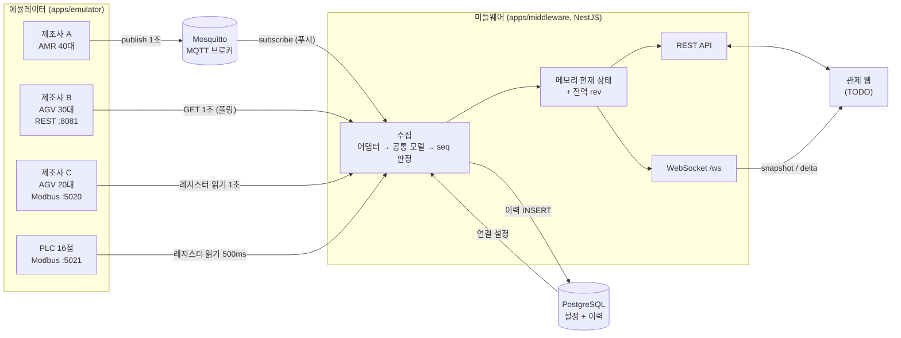
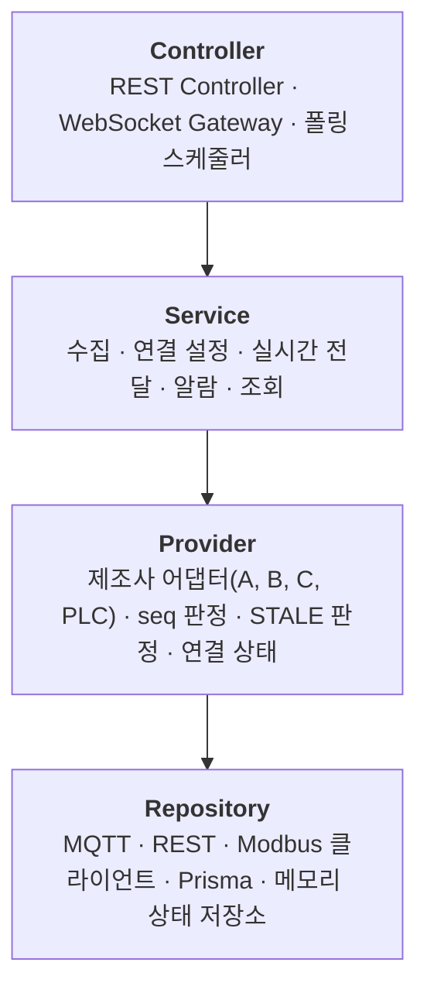
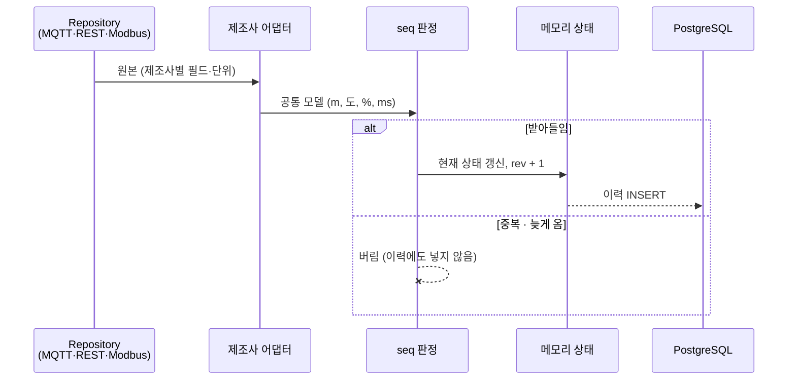
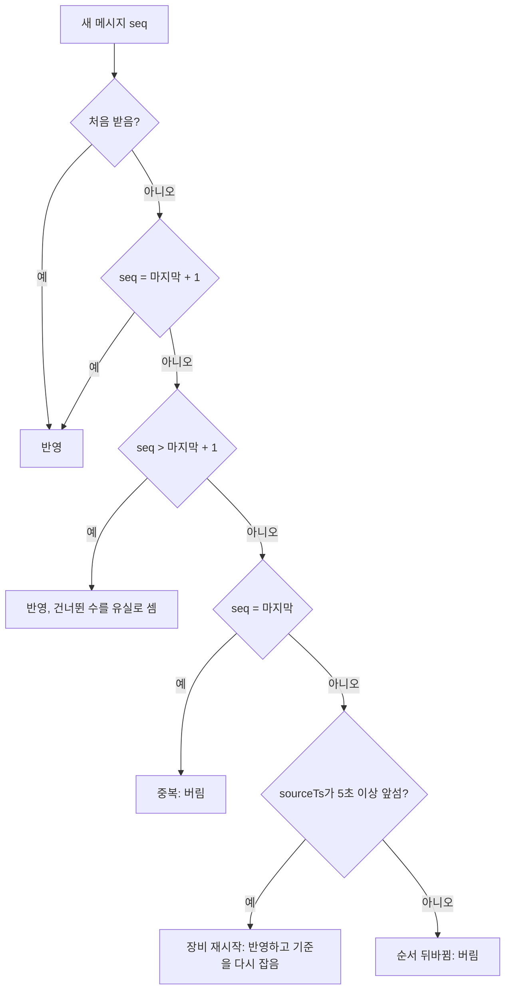
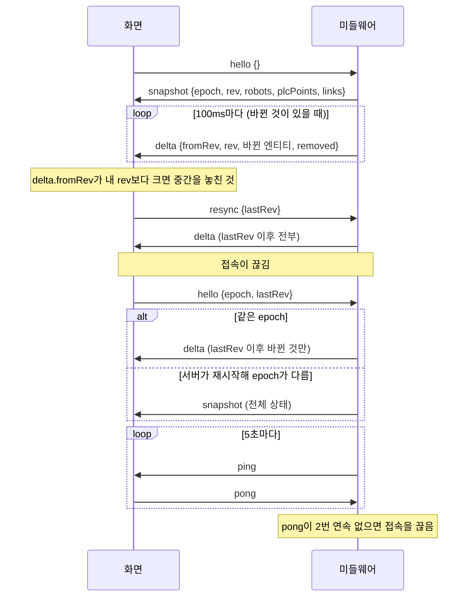
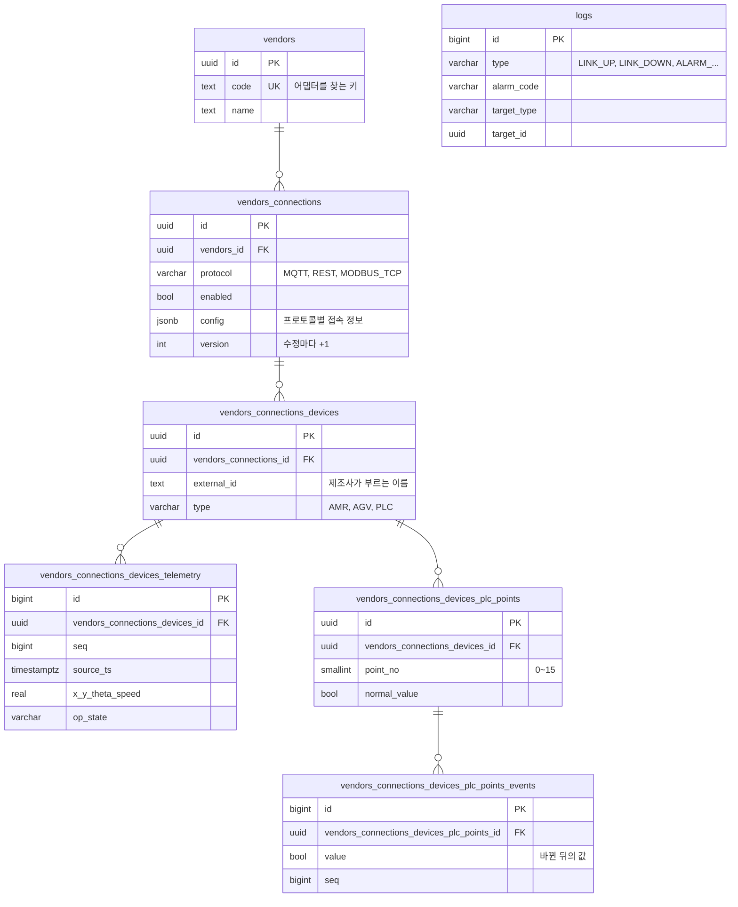

# AGV·AMR 통합 관제 미들웨어

제조사마다 통신 방식이 다른 로봇 90대(MQTT, REST, Modbus TCP)와 PLC 신호 16점을 **하나의 공통 모델로 모아 실시간으로 화면에 전달**하는 미들웨어입니다. 연결 설정은 DB에 있어서 재배포 없이 바꿀 수 있습니다.

| 대상         | 수량 | 통신 방식           | 주기  | 미들웨어 입장 |
| ------------ | ---- | ------------------- | ----- | ------------- |
| 제조사 A AMR | 40대 | MQTT (JSON)         | 1초   | 구독 (푸시)   |
| 제조사 B AGV | 30대 | REST                | 1초   | 폴링          |
| 제조사 C AGV | 20대 | Modbus TCP 레지스터 | 1초   | 폴링          |
| PLC 인터록   | 16점 | Modbus TCP          | 500ms | 폴링          |

## 빠른 시작

Docker와 Docker Compose만 있으면 됩니다.

```bash
docker compose up --build
```

PostgreSQL, MQTT 브로커, 에뮬레이터, 미들웨어 네 컨테이너가 뜹니다. 미들웨어는 시작할 때 테이블을 만들고(`prisma migrate deploy`) 데모 데이터(제조사, 연결, 장비)를 넣습니다. 시드는 여러 번 실행해도 결과가 같습니다.

| 서비스                | 주소                                     |
| --------------------- | ---------------------------------------- |
| 미들웨어 REST         | http://localhost:3000                    |
| 미들웨어 WebSocket    | ws://localhost:3000/ws                   |
| 에뮬레이터 B (REST)   | http://localhost:8081                    |
| 에뮬레이터 C (Modbus) | localhost:5020                           |
| 에뮬레이터 PLC        | localhost:5021                           |
| PostgreSQL            | localhost:5432 (middleware / middleware) |
| MQTT 브로커           | localhost:1883                           |

### 동작 확인

모든 HTTP 응답은 `{ success, data, error }` 구조입니다. 실패하면 `data`가 null이고 `error`에 상태 코드와 메시지가 담깁니다.

```bash
curl http://localhost:3000/health
# {"success":true,"data":{"status":"ok"},"error":null}

# 로봇 90대의 최신 상태 (A 40 + B 30 + C 20). stale=true면 데이터가 끊긴 장비
curl http://localhost:3000/robots
curl http://localhost:3000/robots/{id}

# 로봇 이력 (최신 순, from/to는 ISO 8601, page는 1부터, size는 최대 1000)
curl "http://localhost:3000/robots/{id}/telemetry?from=2026-11-19T00:00:00Z&page=1&size=100"

# PLC 16점의 현재 값과 값이 바뀐 이력
curl http://localhost:3000/plc-points
curl "http://localhost:3000/plc-points/{id}/events?page=1&size=100"

# 연결 목록과 연결 상태 (UP, DOWN, UNKNOWN)
curl http://localhost:3000/connections

# 시스템 로그 (연결 끊김·복구 등, 최신 순, type으로 거를 수 있다)
curl "http://localhost:3000/logs?type=LINK_DOWN&page=1&size=100"

# 지금 열린 알람(최근 순)과 알람 확인 (이미 풀린 알람이면 404)
curl http://localhost:3000/alarms
curl -X POST http://localhost:3000/alarms/{id}/ack

# 에뮬레이터 원본 데이터 확인
docker compose exec mosquitto mosquitto_sub -t 'vendorA/amr/+/state' -v
curl http://localhost:8081/api/vehicles
```

### 연결 설정 바꾸기 (재배포 없음)

```bash
# 연결 하나의 설정 보기와 바꾸기 (version이 다르면 409, 잘못된 config는 400)
curl http://localhost:3000/connections/{id}
curl -X PATCH http://localhost:3000/connections/{id} -H 'content-type: application/json' \
  -d '{"version":1,"rest":{"baseUrl":"http://emulator:8081","pollIntervalMs":1000,"mode":"bulk","timeoutMs":800}}'

# 연결 만들기와 지우기 (장비가 딸린 연결은 지우지 않고 enabled=false로 끈다)
curl http://localhost:3000/vendors
curl -X POST http://localhost:3000/connections -H 'content-type: application/json' \
  -d '{"vendorId":"{vendorId}","name":"새 연결","protocol":"REST","rest":{"baseUrl":"http://emulator:8081","pollIntervalMs":1000,"mode":"bulk","timeoutMs":800}}'
curl -X DELETE http://localhost:3000/connections/{id}
```

미들웨어는 2초마다 DB의 연결 설정을 확인해서, `version`이 바뀐 연결만 내렸다가 새 설정으로 다시 붙입니다.

### 장애 확인

```bash
docker compose stop emulator    # B·C·PLC 연결이 DOWN, 장비가 stale=true, logs에 LINK_DOWN
docker compose start emulator   # 1초에서 10초까지 늘어나는 간격으로 재접속해 스스로 UP
docker compose restart middleware  # 이력의 마지막 행으로 로봇 90대와 PLC 16점 상태를 되살림
```

### 실시간 (WebSocket)

메시지는 `{ "event", "data" }` JSON입니다. `hello`를 보내면 전체 상태가 오고, 이후 100ms마다 바뀐 것만 옵니다.

```bash
npx wscat -c ws://localhost:3000/ws
> {"event":"hello","data":{}}
```

## 전체 구조

결정마다 이유와 대안은 [설계 근거](docs/design-rationale.md)에 정리했습니다.



- 미들웨어는 프로세스 하나입니다. 수집부터 WebSocket 전달까지 내부 브로커 없이 함수 호출로 잇습니다.
- **현재 상태는 메모리**, **DB에는 이력만 INSERT**합니다. 서버를 재시작하면 이력의 장비별 마지막 행으로 메모리를 되살립니다.

### 미들웨어 계층

각 계층은 바로 아래 계층만 부릅니다. 건너뛰기와 같은 계층끼리의 호출은 없습니다.



### 새 제조사를 추가할 때 바뀌는 범위

제조사 어댑터는 `VendorAdapter` 인터페이스 하나(`toCommon(raw) → RobotReading[]`)를 구현하고, 미들웨어는 `vendors.code`로 어댑터를 찾습니다.

| 경우                           | 바뀌는 것                                                                | 바뀌지 않는 것                                 |
| ------------------------------ | ------------------------------------------------------------------------ | ---------------------------------------------- |
| 기존 프로토콜을 쓰는 새 제조사 | 어댑터 class 1개와 테스트, `ingest.module.ts` 등록 1줄, `vendors` 행 1개 | 프로토콜 클라이언트, seq 판정, 상태, WebSocket |
| 새 프로토콜을 쓰는 새 제조사   | 위에 더해 클라이언트 Repository 1개, 접속 정보 DTO 1개                   | seq 판정부터 WebSocket까지 전부                |

## 데이터 흐름과 정합성

### 메시지 한 건의 처리



### seq 판정 (장비별)

장비마다 마지막으로 받아들인 `seq`와 `sourceTs`를 기억하고, 새 메시지를 이렇게 판정합니다. 로봇 상태는 **최신값만 의미가 있다**고 보고 늦게 온 과거 위치는 버립니다.



PLC는 같은 판정을 통과한 뒤, 이전 값과 비트를 비교해 **바뀐 점만** 이벤트로 기록합니다.

### STALE과 연결 끊김

| 판정       | 조건                                                                      |
| ---------- | ------------------------------------------------------------------------- |
| 로봇 STALE | 연결이 DOWN, 또는 3초(주기의 3배) 동안 새 데이터 없음, 또는 지연 3초 초과 |
| PLC STALE  | 연결이 DOWN, 또는 1.5초 동안 새 데이터 없음                               |
| 연결 DOWN  | MQTT는 브로커 연결 종료, REST·Modbus는 3회 연속 실패                      |

연결이 DOWN이 되면 `logs`에 `LINK_DOWN`, 다시 붙으면 `LINK_UP`을 남깁니다. 재접속 간격은 1초에서 10초까지 늘어납니다.

### WebSocket 이어받기 (epoch + rev)

미들웨어는 로봇, PLC 점, 연결을 엔티티로 들고, 바뀔 때마다 **전역 rev**를 1 올려 붙입니다. 화면이 "rev R까지 봤다"고 하면 R 이후 바뀐 엔티티만 보내면 되므로, 처음 접속과 재접속이 같은 코드입니다. **epoch**는 서버가 켜질 때마다 새로 만드는 값이라, epoch가 다르면 rev가 이어지지 않는 것으로 보고 전체 상태를 보냅니다.



느린 화면은 전송 버퍼가 1MB를 넘으면 그 프레임을 건너뛰고, 다음 delta가 그 사이 변화를 합쳐서 보냅니다.

## DB 스키마

테이블과 외래키 컬럼은 부모 테이블의 이름을 사슬로 이어 붙입니다(예: `vendors_connections_devices_id`). 이름만 봐도 소속이 보이게 하려는 규칙입니다. 상태 값 컬럼은 DB enum 대신 varchar를 씁니다.



- 설정 테이블: `vendors`, `vendors_connections`, `vendors_connections_devices`, `vendors_connections_devices_plc_points`
- 이력 테이블: `..._telemetry`(받아들인 로봇 상태 전부), `..._plc_points_events`(값이 바뀔 때만), `logs`(연결과 알람 기록, 추가만)
- 현재 상태 테이블은 따로 두지 않습니다. 이력의 마지막 행이 곧 현재 값입니다.
- TODO: 로그인(조각 11)에서 `roles`, `roles_users`가 추가됩니다.

## 과제 요구 사항과 구현

| 과제 요구                                                  | 상태  | 구현                                                                                                                                            |
| ---------------------------------------------------------- | ----- | ----------------------------------------------------------------------------------------------------------------------------------------------- |
| 필수 1. 에뮬레이터 (90대와 PLC, 끊김·지연·중복·순서 주입)  | 일부  | `apps/emulator`: A 40대 MQTT, B 30대 REST, C 20대 Modbus, PLC 16점. 장애 주입은 TODO                                                            |
| 필수 2. 어댑터 3종과 공통 모델, 새 제조사 추가 범위 증명   | 완료  | `ingest/adapters/vendor-{a,b,c}.adapter.ts`, `plc.adapter.ts`. 범위는 위 "새 제조사" 표                                                         |
| 필수 3. 연결 설정 (드롭다운·토글, 재배포 없이 변경)        | API만 | `POST/PATCH/DELETE /connections`, version 충돌 409, config 검증 400. 설정 화면은 TODO                                                           |
| 필수 4. 실시간 전달 (WebSocket, 재접속 복구, 중복·순서)    | 완료  | `/ws` snapshot·delta·resync·ping, epoch와 rev. 수집 구간은 seq 판정                                                                             |
| 필수 5. 관제 UI (맵, 상태, 연결, PLC, 장애 알림)           | 일부  | 알람 4종(ROBOT_ERROR, DEVICE_STALE, PLC_ABNORMAL, LOW_BATTERY) 판정과 `GET /alarms`, `POST /alarms/{id}/ack`. WebSocket 알람 전달과 화면은 TODO |
| 필수 6. 측정 (지연 p50·p95, 유실률, 복구 시간, CPU·메모리) | TODO  | 조각 13                                                                                                                                         |
| 제출물. `docker compose up` 한 번으로 실행                 | 완료  | `docker-compose.yml`                                                                                                                            |

## 저장소 구조

```text
apps/
  emulator/      로봇 90대와 PLC를 모사하는 별도 프로세스 (NestJS 없음)
    vendor-a/    MQTT 발행        vendor-b/  REST 서버
    vendor-c/    Modbus 서버      plc/       PLC Modbus 서버
    simulation/  로봇 이동 시뮬레이션
  middleware/    미들웨어 서버 (NestJS)
    prisma/      스키마, 마이그레이션, 시드
    src/
      ingest/    수집: 어댑터, seq 판정, 프로토콜 클라이언트, 폴링 스케줄러
      state/     메모리 현재 상태와 rev
      history/   이력 저장소 (telemetry, plc events, logs)
      settings/  연결 설정 저장소
      connection/ 연결 설정 API
      device/    로봇·PLC 조회 API, STALE 판정
      log/       로그 조회 API
      alarm/     알람 판정과 조회·확인 API
      realtime/  WebSocket
      config/    설정값 (@nestjs/config)
infra/mosquitto/ MQTT 브로커 설정
```

## 로컬 개발

Node.js 22와 pnpm 10이 필요합니다.

```bash
pnpm install
pnpm build
pnpm lint
pnpm test
```
