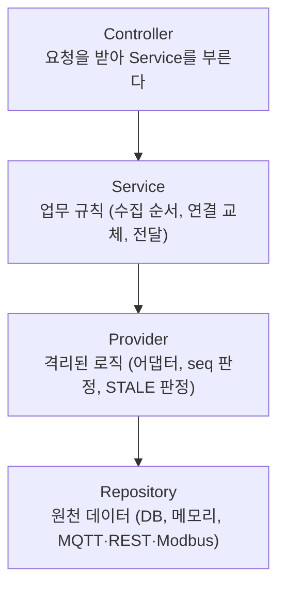
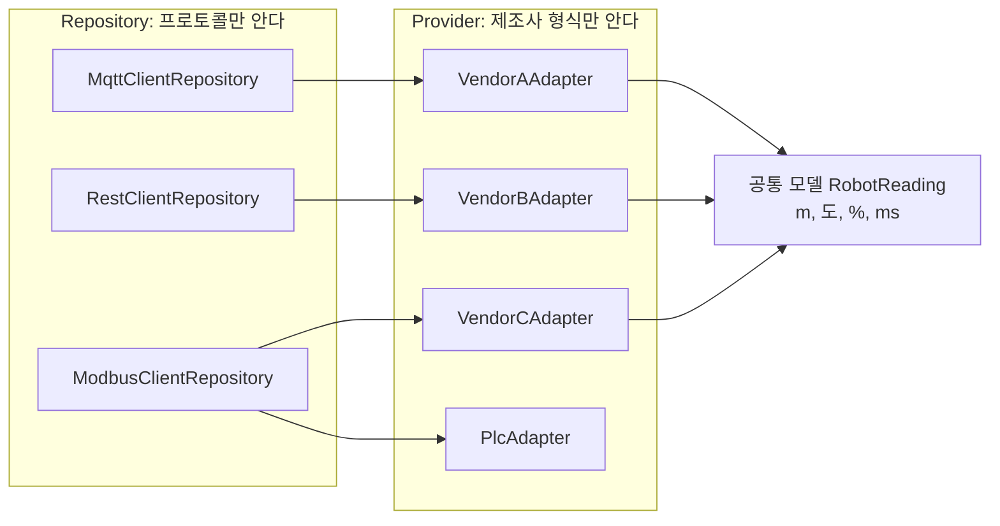
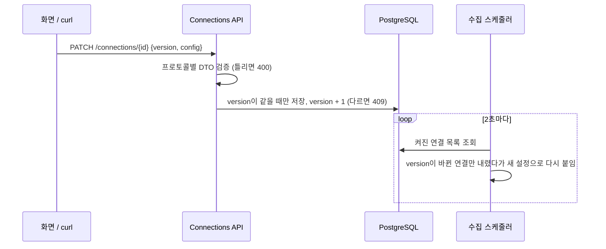
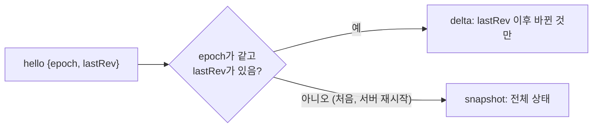
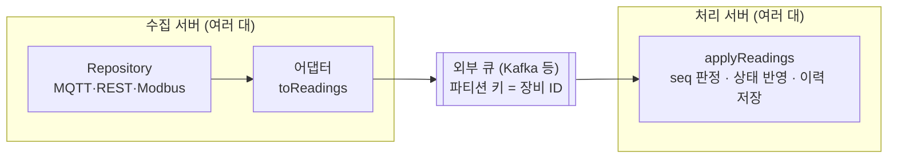
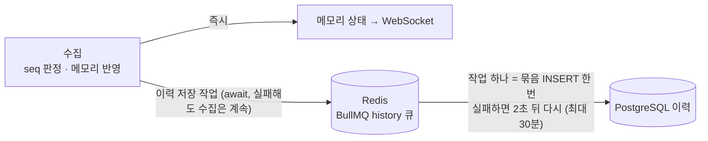
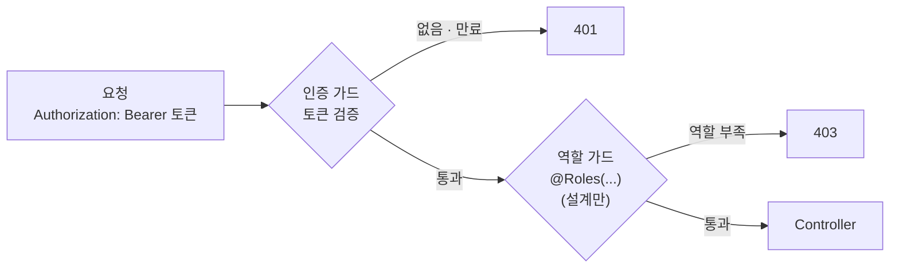

# 설계 근거

이 문서는 "왜 이렇게 만들었는가"를 결정 하나씩 정리합니다. 각 결정은 **결정, 이유, 검토한 대안, 감수한 점** 순서로 적습니다. 실행 방법과 전체 구조는 [README](../README.md)에 있습니다.

모든 결정의 전제는 과제 시나리오입니다. 공장 1곳, 로봇 90대와 PLC 16점, 초당 약 122건(로봇 90건 + PLC 16점 × 초당 2회), 운영자 10명 이내, 기한 2.5일입니다.

## 한눈에 보기

| #   | 결정                                                | 한 줄 이유                                           |
| --- | --------------------------------------------------- | ---------------------------------------------------- |
| 1   | 미들웨어는 프로세스 하나, 실시간 경로에 브로커 없음 | 초당 122건은 한 프로세스로 충분하고 장애 지점이 준다 |
| 2   | Controller, Service, Provider, Repository 4계층     | 원천 접근, 변환, 업무 규칙, 입출구를 떼어 놓는다     |
| 3   | 프로토콜 클라이언트와 제조사 어댑터를 분리          | 새 제조사는 어댑터 하나만 추가하면 된다              |
| 4   | 푸시는 핸들러 등록, 폴링은 스케줄러                 | 프로토콜 성질대로 받고, 폴링이 겹치지 않게 한다      |
| 5   | 연결 설정은 DB에 두고 2초마다 맞춘다                | 재배포 없이 바뀌고 계층 규칙도 지킨다                |
| 6   | 장비별 seq로 판정, 늦게 온 것은 버림                | 관제는 현재 상태를 본다                              |
| 7   | STALE은 주기의 3배 무소식                           | 한두 번 늦은 것과 진짜 끊긴 것을 구분한다            |
| 8   | 현재 상태는 메모리, DB에는 이력만 INSERT            | 쓰기가 단순해지고 DB가 느려도 화면은 멈추지 않는다   |
| 9   | WebSocket, epoch + rev로 snapshot과 delta           | 과제 요구이고, 재접속 복구가 버퍼 없이 된다          |
| 10  | 100ms마다 묶어서 전송                               | 화면 부하가 장비 수와 상관없이 일정하다              |
| 11  | 테이블 이름에 부모 사슬 전체를 붙임                 | 이름만 봐도 소속이 보인다                            |
| 12  | 상태 값 컬럼은 enum 대신 varchar                    | 값이 늘어도 마이그레이션이 필요 없다                 |
| 13  | PostgreSQL 하나, 접속 정보는 JSONB 한 칸            | 설정과 이력을 한곳에, 새 프로토콜에도 스키마 그대로  |
| 14  | 스케일 아웃은 문서로만 (외부 큐, Redis 공유 상태)   | 지금 규모에 필요 없고 마감 안에 검증할 수 없다       |
| 15  | 이력 저장만 Redis + BullMQ 작업으로                 | DB가 멈춰도 이력이 Redis에 쌓였다가 채워진다         |
| 16  | 로그인은 구현, 역할별 기능 차이는 설계만            | 역할 구분은 과제 원문에 요구가 없다                  |

---

## 1. 미들웨어는 프로세스 하나, 실시간 경로에 브로커 없음

- **결정**: 수집, 변환, 판정, 상태, WebSocket 전달을 NestJS 프로세스 하나에서 함수 호출로 잇습니다. MQTT 브로커(Mosquitto)는 제조사 A가 MQTT를 쓰기 때문에 둔 것이지 내부용이 아닙니다.
- **이유**: 초당 122건은 Node.js 프로세스 하나가 여유 있게 처리합니다. 구성 요소가 줄면 장애 지점과 운영할 것이 같이 줄어듭니다.
- **대안**: Redis Streams, NATS, Kafka를 수집과 전달 사이에 두기.
- **감수한 점**: 미들웨어를 여러 대로 늘릴 수 없습니다. 단계 사이를 class 경계로 끊어 두어, 나중에 그 자리에 브로커를 끼울 수 있게 했습니다. 이력 저장은 실시간 경로가 아니라서 Redis 큐로 뺐습니다([15](#15-이력-저장만-redis--bullmq-작업으로)).

## 2. 4계층 구조

- **결정**: 각 계층은 바로 아래 계층만 부릅니다. 건너뛰기(Service → Repository)와 같은 계층끼리의 호출(Provider → Provider)은 하지 않습니다. WebSocket Gateway와 폴링 스케줄러도 Controller 위치에 둡니다.
- **이유**: 장비와 DB는 모두 "원천 데이터"라서 Repository로 묶으면, 위 계층은 데이터가 MQTT에서 왔는지 DB에서 왔는지 몰라도 됩니다. 의존이 한 방향이라 어디를 고치면 어디가 영향을 받는지 바로 보입니다. 어댑터와 seq 판정 같은 Provider는 입출력이 없어서 단위 테스트가 쉽습니다.
- **대안**: Controller와 Service 2계층, 헥사고날(포트와 어댑터) 구조.
- **감수한 점**: 파일과 class가 많아지고, 단순한 조회도 네 계층을 거칩니다.

## 3. 프로토콜 클라이언트와 제조사 어댑터 분리

화살표는 데이터가 흐르는 방향입니다. 호출은 Service가 Provider를 거쳐 Repository로 내려갑니다. PLC는 로봇과 따로 PLC 점 값으로 바뀝니다.

- **결정**: "어떻게 받는가"(프로토콜)와 "받은 것을 어떻게 읽는가"(제조사 형식)를 다른 class로 나눕니다. 어댑터는 `VendorAdapter` 인터페이스(`toCommon(raw)`) 하나만 지키고, 미들웨어는 `vendors.code`로 어댑터를 찾습니다.
- **이유**: 현장에서는 같은 프로토콜을 쓰는 다른 제조사가 계속 늘어납니다. 그때 바뀌는 것이 어댑터 class 하나와 등록·상수 몇 줄, 제조사·장비 행으로 끝나야 합니다(바뀌는 파일 목록은 design.md 4장 표). 과제가 요구한 "새 제조사를 추가할 때 바뀌는 범위"의 증명이 이 구조입니다.
- **대안**: 제조사마다 수신부터 변환까지 통째로 만드는 방식, 변환 규칙을 DB의 매핑 설정(JSON 경로)으로 두는 방식.
- **감수한 점**: 매핑 설정 방식과 달리 새 제조사는 코드 배포가 필요합니다. 단위 변환이나 비트 해석처럼 설정으로 표현하기 어려운 규칙이 많아 코드로 두었습니다.

## 4. 푸시는 핸들러 등록, 폴링은 스케줄러

- **결정**: MQTT는 시작할 때 Service가 Provider를 거쳐 Repository에 수신 핸들러를 등록합니다. REST와 Modbus는 Controller 위치의 스케줄러가 주기마다 Service를 부릅니다. 폴링은 고정 `setInterval`이 아니라 **한 번 끝난 뒤 다음 간격을 다시 거는** 방식(`SchedulerRegistry.addTimeout`)입니다.
- **이유**: 폴링이 느려져도 같은 연결에 요청이 겹치지 않습니다. 연결이 끊기면 다음 간격을 1초에서 10초까지 늘려, 죽은 장비를 1초마다 두드리지 않습니다. 주기 값은 연결 설정(`pollIntervalMs`)에서 오므로 cron 표현식보다 timeout이 맞습니다.
- **대안**: 고정 `setInterval`, `@Cron` 데코레이터, MQTT까지 폴링으로 통일.
- **감수한 점**: 폴링 방식(B, C, PLC)은 데이터가 생긴 뒤 다음 폴링까지 0~1초를 기다리므로 종단 지연이 평균 0.5초 정도 더 나옵니다. 프로토콜의 성질이므로 측정 수치를 프로토콜별로 나눠 보입니다.

## 5. 연결 설정은 DB에 두고 2초마다 맞춤

- **결정**: 연결 설정 API는 DB만 바꾸고, 수집 쪽은 2초마다 DB와 자기 상태를 비교해 바뀐 연결만 교체합니다. 다른 연결은 끊기지 않습니다.
- **이유**: API(connection 모듈)가 수집(ingest 모듈)을 직접 부르지 않아도 되어 모듈과 계층 경계가 깔끔합니다. 서버가 재시작해도 DB가 기준이라 같은 상태로 돌아옵니다. `version`은 두 사람이 동시에 고치는 충돌 감지와 "다시 붙일지" 판단에 함께 씁니다.
- **대안**: API가 저장 직후 수집 Service를 직접 불러 즉시 재시작, 내부 이벤트 버스, PostgreSQL LISTEN/NOTIFY.
- **감수한 점**: 설정이 반영되기까지 최대 2초가 걸립니다. 운영자가 설정을 바꾸는 빈도를 생각하면 문제없다고 봤습니다.

## 6. 장비별 seq 판정, 늦게 온 것은 버림

- **결정**: 장비마다 마지막으로 받아들인 `seq`와 `sourceTs`를 기억하고, 다음 규칙으로 판정합니다.

| 조건                                   | 판정        | 처리                        |
| -------------------------------------- | ----------- | --------------------------- |
| seq = 마지막 + 1                       | 정상        | 반영                        |
| seq > 마지막 + 1                       | 중간 유실   | 반영, 건너뛴 수를 유실로 셈 |
| seq = 마지막                           | 중복        | 버림                        |
| seq < 마지막, sourceTs가 5초 이상 앞섬 | 장비 재시작 | 반영하고 기준을 다시 잡음   |
| seq < 마지막                           | 순서 뒤바뀜 | 버림                        |

- **이유**: 관제 화면은 로봇이 **지금** 어디 있는지를 봅니다. 늦게 온 과거 위치를 반영하면 로봇이 뒤로 튀어 보입니다. 재시작한 장비는 seq가 1부터 다시 시작하므로, 시각이 크게 앞서면 "되감긴 것"이 아니라 "새로 켜진 것"으로 봅니다.
- **대안**: 일정 시간 모았다가 순서대로 재정렬하는 버퍼.
- **감수한 점**: 늦게 온 위치는 이력에도 남지 않습니다. 재정렬 버퍼는 모든 메시지에 지연을 더하므로 관제에는 맞지 않다고 봤습니다. PLC는 같은 판정을 통과한 뒤 값이 바뀐 점만 이벤트로 남깁니다.

## 7. STALE은 주기의 3배 무소식

- **결정**: 로봇은 3초, PLC는 1.5초 동안 새 데이터가 없거나, 연결이 DOWN이거나, 로봇 데이터의 지연(수신 시각 - 원천 시각)이 3초를 넘으면 STALE입니다. REST와 Modbus 연결은 3회 연속 실패하면 DOWN입니다.
- **이유**: 한 번 늦은 것으로 경보를 울리면 화면이 깜빡입니다. 주기의 3배면 두 번 연속 놓친 것이라 "잠깐 늦음"과 "끊김"을 구분할 수 있습니다. STALE은 원본 데이터에 없는 값이라 미들웨어가 판정해야 합니다.
- **대안**: 주기의 2배(민감), 10초 고정(둔감).
- **감수한 점**: 실제 끊김을 화면에 알리기까지 최대 3초가 걸립니다.

## 8. 현재 상태는 메모리, DB에는 이력만 INSERT

- **결정**: 현재 상태 테이블을 두지 않습니다. 받아들인 로봇 상태는 메모리에 반영한 뒤 이력 저장 작업으로 넘겨 이력 테이블에 INSERT합니다([15](#15-이력-저장만-redis--bullmq-작업으로)). 서버가 재시작하면 장비별 마지막 이력 행으로 메모리를 되살립니다.
- **이유**: UPDATE가 없고 INSERT만 있어 쓰기가 단순합니다. 메모리 반영을 먼저 끝내므로 DB가 느리거나 멈춰도 조회와 WebSocket은 최신 상태를 계속 봅니다.
- **대안**: 장비별 최신 상태 테이블에 UPSERT, 1초 묶음 쓰기와 메모리 대기열.
- **감수한 점**: 재시작 때 장비별 마지막 행을 찾는 조회가 한 번 필요합니다. 큐에 남은 작업이 아직 DB에 들어가지 않았다면 재시작 직후의 복구 상태가 그만큼 오래된 값일 수 있습니다.

## 9. WebSocket, epoch + rev로 snapshot과 delta

- **결정**: 엔티티(로봇, PLC 점, 연결)가 바뀔 때마다 전역 `rev`를 1 올려 붙입니다. 화면이 "rev R까지 봤다"고 하면 rev가 R보다 큰 엔티티만 보냅니다. 서버가 켜질 때마다 새 `epoch`를 만들고, epoch가 다르면 전체 상태(snapshot)를 보냅니다.
- **이유**: 처음 접속(R = 0)과 재접속 이어받기가 같은 코드입니다. 지난 메시지를 쌓아 둘 버퍼가 없습니다. 화면은 `delta.fromRev`가 자기 rev와 같을 때만 반영하므로 중복과 순서가 화면 쪽에서도 지켜지고, 다르면 `resync`로 다시 맞춥니다.
- **대안**: 이벤트 로그와 오프셋 재전송, socket.io의 자동 재접속.
- **감수한 점**: 끊긴 동안의 중간 경로는 다시 보내지 않고 최신 상태만 줍니다. 그 사이의 기록은 `logs` 조회로 채웁니다.

### SSE가 아니라 WebSocket인 이유

- **결정**: 서버 → 화면 실시간 전달에 WebSocket(`ws`)을 씁니다.
- **이유**: 과제 필수 4항목이 "WebSocket으로 전달"을 명시합니다. 이어받기에 필요한 `hello`, `resync`, `ping/pong`도 같은 연결로 주고받을 수 있습니다.
- **대안**: SSE(Server-Sent Events). 이 시스템의 실시간 데이터는 서버 → 화면 한 방향이라 SSE로도 충분했습니다. SSE는 HTTP 그대로라 프록시를 잘 통과하고, `Last-Event-ID`로 재접속 이어받기를 브라우저가 기본 지원합니다. 화면 → 서버 요청(resync, 알람 확인)은 REST로 보내면 됩니다.
- **감수한 점**: 재접속과 생존 확인(ping/pong)을 직접 구현했습니다. 과제 요구가 없었다면 SSE가 더 단순한 선택이었습니다.

## 10. 100ms마다 묶어서 전송

- **결정**: Gateway가 100ms마다 "이 rev 이후 바뀐 것"을 Service에서 가져와 화면마다 보냅니다. 화면의 전송 버퍼가 1MB를 넘으면 그 프레임을 건너뛰고, 다음 delta가 그 사이 변화를 합쳐 보냅니다.
- **이유**: 메시지가 올 때마다 보내면 장비 수만큼 프레임이 늘어납니다. 묶으면 초당 10프레임으로 고정되어 500대에서도 화면 부하가 일정합니다. Gateway가 가져가는 구조라 Service가 위 계층(Gateway)을 부르지 않습니다.
- **대안**: 메시지마다 즉시 전송, Service가 Gateway에 이벤트를 밀어 넣기.
- **감수한 점**: 지연이 최대 100ms 늘어납니다.

## 11. 테이블 이름에 부모 사슬 전체를 붙임

- **결정**: `vendors` → `vendors_connections` → `vendors_connections_devices` → `vendors_connections_devices_telemetry`처럼 부모 이름을 이어 붙입니다. 외래키 컬럼도 `vendors_connections_devices_id`처럼 부모 테이블 이름 그대로입니다.
- **이유**: 테이블 이름만 읽어도 어디에 속한 데이터인지 보입니다. `devices`, `device_id` 같은 짧은 이름은 테이블이 늘면 무엇의 장비인지 헷갈립니다.
- **대안**: 짧은 이름(`devices`, `telemetry`, `device_id`).
- **감수한 점**: 이름이 깁니다.

## 12. 상태 값 컬럼은 enum 대신 varchar

- **결정**: `protocol`, `type`, `op_state`, `level` 같은 컬럼을 DB enum이 아니라 varchar로 둡니다. 허용 값은 코드의 타입과 DTO 검증(class-validator)이 지킵니다.
- **이유**: PostgreSQL enum은 값을 추가하거나 이름을 바꿀 때마다 마이그레이션이 필요하고, 값을 지우기는 더 어렵습니다. 새 제조사나 새 상태가 생길 때 DB를 건드리지 않으려는 것입니다.
- **대안**: PostgreSQL enum 타입, 코드 테이블(lookup table)과 외래키.
- **감수한 점**: DB가 잘못된 값을 막아 주지 않습니다. 쓰는 곳이 미들웨어 하나뿐이라 코드 검증으로 충분하다고 봤습니다.

## 13. PostgreSQL 하나, 접속 정보는 JSONB 한 칸

- **결정**: 설정과 이력을 PostgreSQL 하나에 둡니다(Prisma). 프로토콜마다 모양이 다른 접속 정보는 `vendors_connections.config` JSONB 한 칸에 담고, 저장 전에 프로토콜별 DTO로 검증합니다.
- **이유**: 하루 약 780만 행(초당 90행)은 일반 PostgreSQL로 감당됩니다. 저장소가 하나면 운영할 것도 하나입니다. JSONB라 새 프로토콜이 생겨도 테이블을 고치지 않습니다.
- **대안**: TimescaleDB나 InfluxDB를 이력용으로 따로 두기, 프로토콜별 설정 테이블.
- **감수한 점**: 장기 보관과 다운샘플링이 불편하고, config의 형식은 DB가 아니라 코드가 보장합니다.

## 14. 스케일 아웃할 때의 확장 방향 (구현하지 않음)

- **결정**: 지금은 서버 한 대로 둡니다. 서버를 여러 대로 늘려야 할 때 어디를 어떻게 바꿀지만 정해 둡니다.
- **이유**: 90대, 초당 122건에는 필요 없고, 마감 안에 다중 서버 구성을 제대로 검증할 수 없습니다. 검증하지 못한 구성을 넣는 것보다 바꿀 자리를 정확히 적어 두는 편이 낫다고 봤습니다.

### 수집: 공통 형식 변환 뒤에 외부 큐

- 큐는 `IngestService.handleRaw`에서 공통 형식으로 바꾼 직후(`toReadings` 다음), 지금 연결별 `SerialQueue`가 있는 자리에 둡니다. 변환까지는 수집 서버, `applyReadings`(seq 판정, 상태 반영, 저장)부터는 처리 서버가 맡습니다.
- 파티션 키를 장비 ID로 잡으면 한 장비의 메시지는 한 파티션에서 순서대로 처리되어, 지금의 seq 판정 규칙이 그대로 통합니다.
- 장비 앞에는 큐를 둘 수 없습니다. 장비 프로토콜은 제조사가 정한 것이라 바꿀 수 없고, 제조사 A는 MQTT 브로커가 이미 그 역할을 합니다.

### 실시간 전달: 상태와 rev를 Redis로

- Redis pub/sub만 더해서는 안 됩니다. 지금은 현재 상태와 rev가 프로세스 메모리에 있어서, 서버마다 rev가 따로 올라가고 다른 서버에 붙은 화면은 이어받기를 할 수 없습니다.
- 그래서 현재 상태와 rev를 Redis로 옮기고(rev는 `INCR`로 모든 서버가 하나를 공유), 바뀐 사실은 Redis pub/sub으로 알립니다. 각 서버의 Gateway는 알림을 받거나 100ms마다 Redis에서 "이 rev 이후 바뀐 것"을 읽어 자기 화면에 보냅니다. 그러면 화면은 어느 서버에 다시 붙어도 같은 epoch와 rev로 이어받습니다.
- 수집 연결은 한 연결을 한 서버만 맡도록 나누는 규칙(연결 ID 해시나 잠금)이 필요합니다. 두 서버가 같은 장비를 폴링하면 요청이 두 배가 됩니다.

- **대안**: 처음부터 Redis와 Kafka를 넣어 다중 서버로 만들기, 화면 접속만 sticky session으로 한 서버에 고정하기.
- **감수한 점**: 지금 구성은 서버 한 대가 죽으면 재시작까지 수집과 전달이 멈춥니다(재시작하면 이력으로 상태를 되살림). 위 방향은 설계만 했고 측정하지 않았습니다.

## 15. 이력 저장만 Redis + BullMQ 작업으로

- **결정**: seq 판정과 메모리 반영은 지금처럼 연결별 메모리 SerialQueue에서 바로 처리합니다. 받아들인 로봇 상태와 바뀐 PLC 값의 DB 저장만 BullMQ 작업으로 Redis에 넣고, 같은 프로세스의 워커가 묶음 INSERT(`createMany`)로 씁니다.
- **이유**:
  - DB가 멈춰도 이력이 사라지지 않습니다. 작업이 Redis에 쌓였다가 DB가 돌아오면 다시 시도되어 빈 구간이 채워집니다. Postgres를 27초 멈췄다 켠 시험에서 그 사이 약 2,400행이 모두 들어왔습니다.
  - 연결별 순서 보장은 메모리 SerialQueue가 이미 합니다. BullMQ에서 같은 키끼리 순서를 지키는 그룹 기능은 Pro(유료) 전용이라 쓰지 않았습니다. 이력은 `source_ts`로 정렬해 읽으므로 저장 순서가 바뀌어도 됩니다.
  - 실시간 경로(수집 → 메모리 → WebSocket)에 Redis 왕복을 넣지 않아 지연이 늘지 않습니다.
- **대안**: 수집 전체를 큐로 보내기(메시지마다 Redis 왕복이 생기고, 연결별 순서를 큐에서 다시 지켜야 한다), 메모리 대기열과 1초 묶음 쓰기(프로세스가 죽으면 대기열이 사라진다), Redis Streams나 Kafka(운영할 것이 늘어난다).
- **감수한 점**:
  - Redis가 하나 늘었습니다.
  - Redis가 멈춘 동안의 이력은 빠집니다. 큐에 넣기는 기다리지 않고 바로 실패하게 해 두었습니다(`enableOfflineQueue: false`). 그래서 수집과 화면은 멈추지 않습니다.
  - 30분을 넘긴 DB 장애의 작업은 실패 목록에 최근 1,000건만 남습니다.

## 16. 로그인은 구현, 역할별 기능 차이는 설계만

- **결정**: 로그인은 구현합니다. 데모 계정 3개(viewer, operator, admin), argon2id 비밀번호 해시, `POST /auth/login`의 JWT 발급, `roles`와 `roles_users` 테이블이 있습니다. 다만 **역할에 따라 쓸 수 있는 기능을 다르게 두지는 않습니다**. 로그인한 사용자는 역할과 상관없이 같은 기능을 씁니다. 역할별 차이는 아래 설계로만 남깁니다.
- **이유**: 과제 안내의 필수 6항목과 가점 항목 어디에도 역할 구분이 없습니다. 설계문서 양식 7장의 "인증·권한" 항목에는 로그인 구현과 이 설계로 답하고, 남은 시간은 필수 항목(장애 주입, 측정, 화면)에 씁니다.

설계한 역할별 기능은 다음과 같습니다.

| 역할     | 할 수 있는 것                                            |
| -------- | -------------------------------------------------------- |
| VIEWER   | 조회 API 전부, WebSocket 실시간 수신                     |
| OPERATOR | VIEWER에 더해 알람 확인 (`POST /alarms/{id}/ack`)        |
| ADMIN    | OPERATOR에 더해 연결 생성·수정·삭제, 장애 주입 화면 조작 |

- **인증 가드 (로그인 범위)**: 전역(`APP_GUARD`)으로 걸고 `/health`, `/auth/login`만 예외로 둡니다. WebSocket은 `hello`의 `token`을 Gateway가 검증하고, 틀리면 에러를 보내고 접속을 끊습니다.
- **역할 가드 (설계만)**: Controller 메서드에 `@Roles('OPERATOR')`, `@Roles('ADMIN')`처럼 붙이면 됩니다. 가드는 Controller 앞에서 끝나므로 4계층 규칙에 영향이 없습니다. 토큰에 이미 역할이 들어 있어 가드 하나와 데코레이터만 더하면 됩니다.
- **기록**: 알람 확인 로그(`ALARM_ACKED`)의 `logs.roles_users_id`에 확인한 사용자를 남깁니다.
- **대안**: 역할 가드까지 구현하기.
- **감수한 점**: 로그인한 사용자라면 VIEWER도 연결 설정을 바꿀 수 있습니다. 실제 현장에 두기 전에는 역할 가드가 필요합니다.
