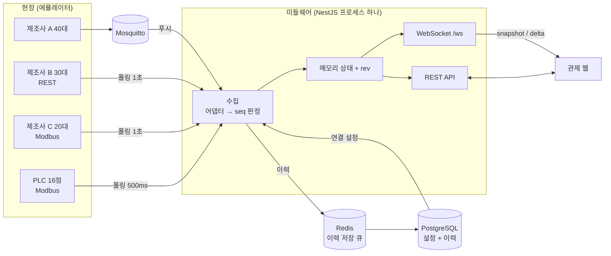
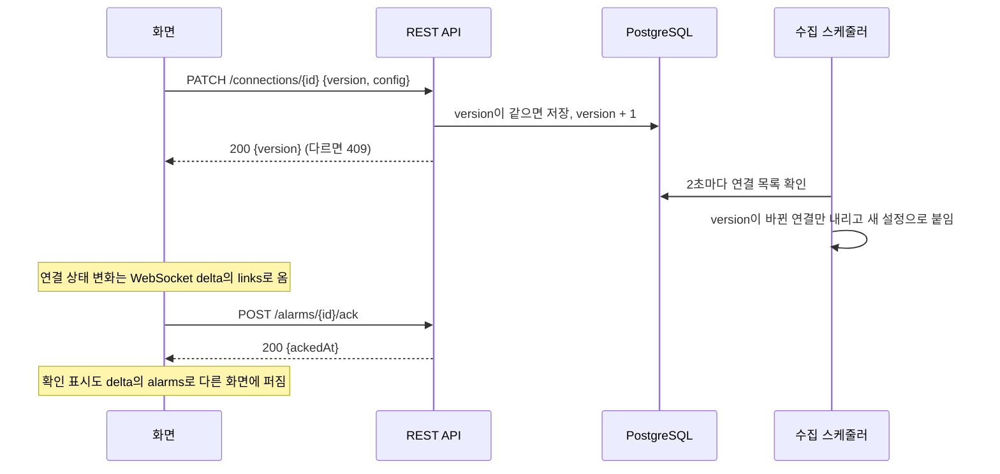
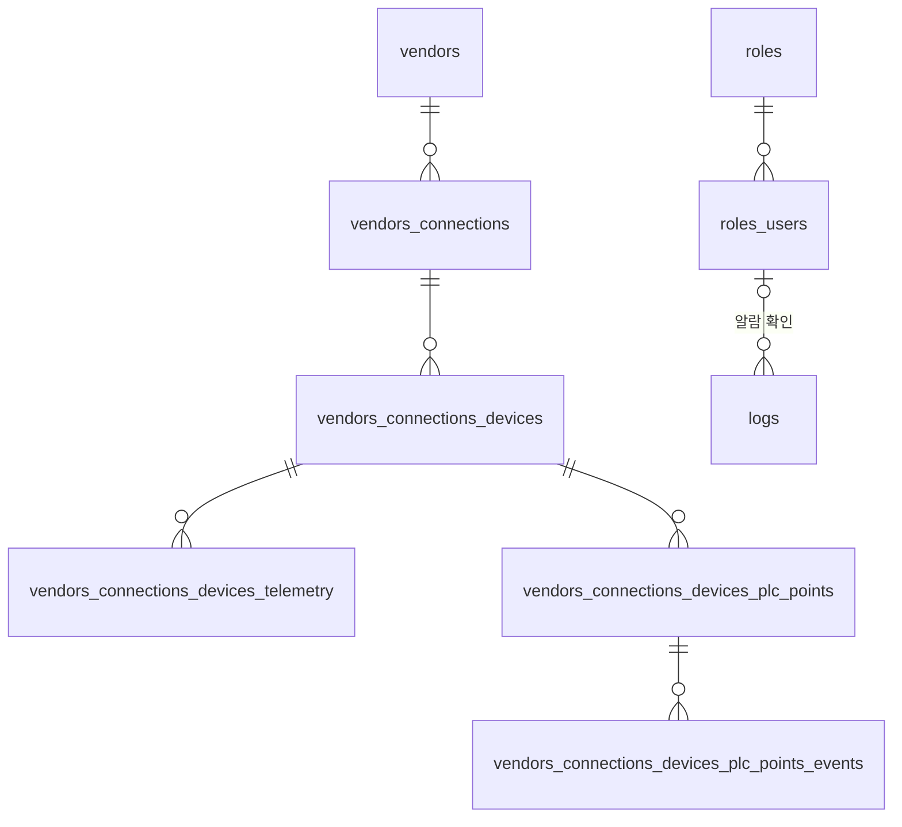

# 설계 문서: 멀티 프로토콜 AGV·AMR 통합 관제 미들웨어

「설계문서\_양식」의 목차를 따릅니다. 실행 방법은 [README](../README.md), API와 WebSocket 명세는 [인터페이스 명세](interface.md), 결정별 근거는 [설계 근거](design-rationale.md), 측정 원자료는 [측정 결과](measurements.md)에 있습니다.

## 1. 요약

**무엇을 만들었는가**

- 제조사마다 통신 방식이 다른 로봇 90대(MQTT, REST, Modbus TCP)와 PLC 16점을 공통 모델로 모아, 웹 화면에 WebSocket으로 실시간 전달하는 NestJS 미들웨어입니다.
- 연결 설정(프로토콜, 접속 정보, 켜고 끄기)은 DB에 있어서 API로 바꾸면 재배포 없이 그 연결만 다시 붙습니다.
- 현장을 대신하는 에뮬레이터가 90대와 PLC를 모사하고, 끊김·지연·중복·순서 뒤바뀜·유실을 주입합니다.

**핵심 설계 결정 3가지**

1. **어댑터 패턴**: 프로토콜 클라이언트(Repository)와 제조사 어댑터(Provider)를 나눴습니다. 새 제조사는 어댑터 class 하나, 등록 1줄, DB 행 하나로 추가됩니다.
2. **최신값 우선 + 두 구간의 순번**: 현장 → 미들웨어 구간은 장비별 `seq`로 중복과 늦게 온 메시지를 버리고, 미들웨어 → 화면 구간은 전역 `rev`와 서버 `epoch`로 재접속 때 바뀐 것만 이어받습니다.
3. **설정은 DB, 상태는 메모리, 이력은 큐를 거쳐 DB**: 실시간 경로에 DB와 브로커가 끼지 않아 DB가 멈춰도 화면은 멈추지 않습니다.

**달성한 수치** ([10장](#10-측정-결과))

- 종단 지연 p95: MQTT 56ms, Modbus 457ms, REST 858ms (폴링 대기 포함). 정상 상태 유실 0%.
- 중복 30%·뒤바뀜 30% 주입에서 화면의 seq가 뒤로 간 횟수 0.
- 현장 연결 복구: 끊김을 풀고 1~1.8초 안에 새 데이터가 화면에 닿음. 화면 재접속 복구 4ms.
- 미들웨어 CPU 평균 5.5%(코어 1개 기준), 메모리 177MB.

**달성하지 못한 것** ([12장](#12-한계와-다음-단계))

- TODO: 관제 화면, 연결 설정 화면, 장애 주입 화면 진행 상황에 맞춰 채웁니다.
- 역할별 기능 차이, 이력 보관 기간 정리, 500대 부하 시험은 설계만 했습니다.

## 2. 문제 정의와 가정

**풀려는 문제**: 공장 한 곳에 제조사가 다른 로봇과 PLC가 섞여 있고, 제조사마다 통신 방식과 데이터 형식이 다릅니다. 운영자는 이 모두를 **한 화면에서 지금 상태 그대로** 보고, 연결이 바뀌어도 개발자 없이 화면에서 설정을 바꿀 수 있어야 합니다.

**사용자**: 관제실 운영자입니다. 로봇 위치와 상태, 연결 끊김, PLC 인터록 신호, 알람을 보고 확인합니다. 현장 연결 정보를 바꾸는 관리자도 같은 화면을 씁니다.

| 대상         | 수량 | 통신 방식           | 주기  | 미들웨어 입장 |
| ------------ | ---- | ------------------- | ----- | ------------- |
| 제조사 A AMR | 40대 | MQTT (JSON)         | 1초   | 구독 (푸시)   |
| 제조사 B AGV | 30대 | REST                | 1초   | 폴링          |
| 제조사 C AGV | 20대 | Modbus TCP 레지스터 | 1초   | 폴링          |
| PLC 인터록   | 16점 | Modbus TCP          | 500ms | 폴링          |

초당 들어오는 메시지는 약 122건(로봇 90건 + PLC 16점 × 초당 2회)입니다.

**직접 세운 가정**

| #   | 가정                                                                   | 근거                                                                                   |
| --- | ---------------------------------------------------------------------- | -------------------------------------------------------------------------------------- |
| A1  | 모든 원본 메시지는 장비별 순번(seq)과 발생 시각(ts)을 가진다           | 중복·순서 판정과 지연 측정에 둘 다 필요하다. Modbus는 레지스터에 담는다                |
| A2  | 로봇 상태는 최신값만 의미가 있다                                       | 관제 화면은 현재 위치를 본다. 늦게 온 과거 위치는 버려도 된다                          |
| A3  | PLC 신호와 알람은 변화 하나하나가 의미가 있다                          | 인터록 변화를 놓치면 안 되므로 상태가 아니라 이벤트로 저장한다                         |
| A4  | 제조사 B는 전체 차량 목록을 한 번에 주는 API를 가진다                  | 30대를 1초마다 따로 부르면 초당 30요청이다. 차량별 조회도 두고 설정(`mode`)으로 고른다 |
| A5  | 제조사 C는 Modbus 서버 1대에 차량 20대가 레지스터 블록으로 나뉘어 있다 | 집중형 컨트롤러 구조를 따랐다. 차량당 16레지스터                                       |
| A6  | 맵은 2D 평면 좌표(m)와 방향각 하나다                                   | 3D는 가점 항목이라 좌표 모델만 열어 둔다                                               |
| A7  | 운영자는 한 공장, 동시 접속 10명 이내다                                | 시나리오가 공장 1곳이다. 미들웨어를 단일 인스턴스로 두는 근거다                        |
| A8  | 에뮬레이터와 미들웨어는 같은 호스트 시계를 쓴다                        | docker compose 한 대에서 돌리므로 지연 측정에 시계 보정이 필요 없다                    |

## 3. 요구 사항

| 구분   | 요구 사항                                                      | 목표 수치                              | 달성 여부                                               |
| ------ | -------------------------------------------------------------- | -------------------------------------- | ------------------------------------------------------- |
| 기능   | 에뮬레이터: 90대와 PLC 모사, 끊김·지연·중복·뒤바뀜 주입        | 90대 + 16점, 장애 4종 이상             | 달성 (API로 주입, 유실까지 5종). 화면 조작은 TODO       |
| 기능   | 어댑터 3종으로 공통 모델 정규화, 새 제조사 추가 범위 증명      | MQTT·REST·Modbus TCP                   | 달성 ([4장](#새-제조사를-추가할-때-바뀌는-범위))        |
| 기능   | 드롭다운·토글로 프로토콜과 접속 정보를 바꾸면 재배포 없이 변경 | 변경 후 수 초 안에 그 연결만 다시 붙음 | API 달성 (2초 주기 반영). 화면은 TODO                   |
| 기능   | WebSocket 전달, 재접속 시 현재 상태 복구, 중복·순서 처리       | 재접속 후 바뀐 것만, 화면 seq 역행 0   | 달성                                                    |
| 기능   | 관제 UI: 맵 위 90대, 연결 상태, PLC, 장애 알림                 | 90대 실시간 표시                       | 데이터(조회 API, WebSocket, 알람 4종) 달성. 화면은 TODO |
| 기능   | 측정: 지연 p50·p95, 유실률, 복구 시간, CPU·메모리              | 스크립트 한 번으로 4종                 | 달성 (`scripts/measure.mjs`)                            |
| 비기능 | 종단 지연                                                      | p95 1초 이내 (폴링 1초 주기 포함)      | 달성: 최대 REST p95 858ms                               |
| 비기능 | 처리량                                                         | 초당 122건을 CPU 여유 있게             | 달성: CPU 평균 5.5%, 최대 8.8%                          |
| 비기능 | 현장 연결 복구                                                 | 끊김 해제 후 10초 안에 자동 복구       | 달성: 1~1.8초 (재접속 간격 1~10초 증가)                 |
| 비기능 | 화면 재접속 복구                                               | 1초 이내                               | 달성: 4ms                                               |
| 비기능 | DB 장애 중 실시간 유지                                         | DB가 멈춰도 화면 갱신 계속             | 달성: 이력은 큐(Redis)에 쌓였다가 DB가 돌아오면 채워짐  |

## 4. 전체 아키텍처

### 구성도 (현장 → 수집 → 서버 → 화면)

### 데이터 흐름

1. Repository(MQTT·REST·Modbus 클라이언트)가 원본을 받습니다. MQTT는 수신 핸들러, REST·Modbus는 연결별 폴링 루프입니다.
2. 제조사 어댑터가 공통 모델(m, 도, %, ms)로 바꿉니다.
3. seq 판정이 중복과 늦게 온 메시지를 버리고, 받아들인 것만 메모리 상태에 반영하며 전역 rev를 올립니다.
4. 받아들인 것은 이력 저장 작업으로 Redis 큐에 넣고, 작업이 PostgreSQL에 묶어서 INSERT합니다.
5. WebSocket Gateway가 100ms마다 "화면이 본 rev 이후 바뀐 것"을 모아 보냅니다.
6. 상태 판정(STALE, 연결 DOWN, 알람)은 주기적으로 메모리 상태를 보고 바뀌면 rev를 올립니다. 그래서 같은 delta로 화면에 갑니다.

### 명령 흐름 (설정 변경과 알람 확인)

### 새 제조사를 추가할 때 바뀌는 범위

| 경우                           | 바뀌는 것                                                                | 바뀌지 않는 것                                       |
| ------------------------------ | ------------------------------------------------------------------------ | ---------------------------------------------------- |
| 기존 프로토콜을 쓰는 새 제조사 | 어댑터 class 1개와 테스트, `ingest.module.ts` 등록 1줄, `vendors` 행 1개 | 프로토콜 클라이언트, seq 판정, 상태, WebSocket, 화면 |
| 새 프로토콜을 쓰는 새 제조사   | 위에 더해 클라이언트 Repository 1개, 접속 정보 DTO 1개                   | seq 판정부터 화면까지 전부                           |

어댑터는 `VendorAdapter` 인터페이스(`toCommon(raw) → RobotReading[]`) 하나만 지키고, 미들웨어는 `vendors.code`로 어댑터를 찾습니다.

## 5. 구성 요소별 책임

| 구성 요소   | 책임                                                                  | 기술                                        | 선택 이유                                                                       |
| ----------- | --------------------------------------------------------------------- | ------------------------------------------- | ------------------------------------------------------------------------------- |
| 에뮬레이터  | 로봇 90대와 PLC 16점 모사, 그룹별 장애 주입(`:8090/faults`)           | Node.js, TypeScript, mqtt.js, modbus-serial | 미들웨어와 코드를 공유하지 않는 별도 프로세스라 실제 현장처럼 네트워크를 거친다 |
| MQTT 브로커 | 제조사 A 메시지 중계                                                  | Eclipse Mosquitto 2                         | 설정 파일 하나로 뜨고 가볍다                                                    |
| 미들웨어    | 수집, 공통 모델 변환, seq 판정, 상태, 알람, REST API, WebSocket, 측정 | NestJS 11, TypeScript strict                | 과제 권장 스택. 모듈·DI로 계층을 강제하기 쉽다                                  |
| PostgreSQL  | 연결 설정과 이력(로봇 상태, PLC 변화, 로그)                           | PostgreSQL 16, Prisma 6                     | 설정과 이력을 한곳에. 접속 정보는 JSONB 한 칸                                   |
| Redis       | 이력 저장 작업 큐                                                     | Redis 7.4, BullMQ                           | DB가 멈춰도 이력이 쌓였다가 채워진다. 실시간 경로에는 넣지 않는다               |
| 관제 웹     | TODO: 화면 조각에 맞춰 채웁니다                                       | TODO                                        | TODO                                                                            |

미들웨어 내부는 4계층이고 각 계층은 바로 아래 계층만 부릅니다.

| 계층       | 하는 일                      | 이 프로젝트의 class                                                         |
| ---------- | ---------------------------- | --------------------------------------------------------------------------- |
| Controller | 요청을 받아 Service를 부른다 | REST Controller, WebSocket Gateway, 수집·알람 스케줄러                      |
| Service    | 업무 규칙                    | 수집, 연결 설정, 실시간 전달, 알람, 조회, 측정                              |
| Provider   | Repository 조합, 격리된 로직 | 제조사 어댑터 4종, seq 판정, STALE 판정, 연결 상태, 알람 판정, 이력 큐 넣기 |
| Repository | 원천 데이터                  | MQTT·REST·Modbus 클라이언트, Prisma 저장소, 메모리 상태 저장소              |

## 6. 데이터 모델과 메시지 스키마

### 공통 데이터 모델

| 모델      | 필드                                                                                                                    |
| --------- | ----------------------------------------------------------------------------------------------------------------------- |
| 로봇 상태 | `seq`, `sourceTs`, `receivedTs`, `x`, `y`(m), `theta`(도), `speed`(m/s), `batteryPct`, `opState`, `errorCode`, `loaded` |
| PLC 점    | `pointNo`(0~15), `value`, `normalValue`, `abnormal`, `changedAt`, `stale`                                               |
| 연결 상태 | `connectionId`, `status`(UNKNOWN, UP, DOWN), `changedAt`                                                                |
| 알람      | `code`, `level`, `targetType`, `targetId`, `message`, `raisedAt`, `ackedAt`                                             |

`opState`는 `IDLE`, `MOVING`, `CHARGING`, `PAUSED`, `ERROR`입니다. 모든 엔티티는 바뀔 때 받은 전역 `rev`를 함께 가집니다. `stale`은 원본에 없는 값이라 미들웨어가 판정합니다(로봇 3초, PLC 1.5초 무소식, 또는 연결 DOWN, 또는 로봇 지연 3초 초과).

### 프로토콜별 매핑표

| 공통 필드  | A: MQTT JSON                                    | B: REST JSON                         | C: Modbus 레지스터 (차량 n의 시작 = 100 + 16n) |
| ---------- | ----------------------------------------------- | ------------------------------------ | ---------------------------------------------- |
| 장비 식별  | 토픽 `vendorA/amr/{serial}/state`               | `vehicleId`                          | 블록 번호 n                                    |
| seq        | `seq`                                           | `sequence`                           | +0, +1 (uint32)                                |
| sourceTs   | `ts` (ISO 8601)                                 | `timestamp` (epoch ms)               | +2 ~ +4 (uint48, ms)                           |
| x, y       | `pose.x`, `pose.y` (m)                          | `position.xMm`, `yMm` (mm → ÷1000)   | +5, +6 (int16, cm → ÷100)                      |
| theta      | `pose.theta` (rad → 도)                         | `headingDeg` (도, 0~360으로 정규화)  | +7 (uint16, 0.1도 → ÷10)                       |
| speed      | `velocity` (m/s)                                | `speedMmS` (mm/s → ÷1000)            | +8 (uint16, cm/s → ÷100)                       |
| batteryPct | `battery.soc` (0~1 → ×100)                      | `batteryLevel` (0~100)               | +9 (uint16, %)                                 |
| opState    | `mode` (idle, driving, charging, paused, fault) | `status` (IDLE, RUN, CHG, STOP, ERR) | +10 (0~4)                                      |
| errorCode  | `fault.code` (없으면 null)                      | `errorCode` (빈 문자열이면 null)     | +11 (0이면 null)                               |
| loaded     | `payload.loaded`                                | `hasLoad`                            | +12 비트 0                                     |

PLC는 입력 레지스터 0의 비트 0~15에 16점, 1~2에 seq(uint32), 3~5에 발생 시각(uint48 ms)을 담습니다. 값과 seq를 한 요청으로 읽어야 어긋나지 않아서 코일 16개가 아니라 워드 하나에 담았습니다. 제조사 C는 Modbus 한 요청 상한(125레지스터) 안에서 블록을 나눠 읽습니다.

### 저장 구조와 보관 정책

| 묶음 | 테이블                                                                                                                           | 쓰는 시점                                    |
| ---- | -------------------------------------------------------------------------------------------------------------------------------- | -------------------------------------------- |
| 설정 | `vendors`, `vendors_connections`(config JSONB, version), `vendors_connections_devices`, `..._plc_points`, `roles`, `roles_users` | 시드와 연결 설정 API                         |
| 이력 | `vendors_connections_devices_telemetry`                                                                                          | 받아들인 로봇 상태마다 한 행 (초당 90행)     |
| 이력 | `vendors_connections_devices_plc_points_events`                                                                                  | PLC 점의 값이 바뀐 순간에만                  |
| 이력 | `logs`                                                                                                                           | 연결 UP·DOWN, 알람 발생·해제·확인. 추가만 함 |

- 현재 상태 테이블은 없습니다. 현재 상태는 메모리에 있고, 재시작하면 장비별 마지막 이력 행으로 되살립니다.
- 테이블과 외래키 이름은 부모 사슬 전체를 붙이고, 상태 값 컬럼은 enum 대신 varchar입니다([설계 근거 11·12장](design-rationale.md)).
- 보관 정책(설계만, 구현하지 않음): telemetry는 24시간(하루 약 780만 행, 1시간마다 오래된 행 삭제), PLC 이벤트와 logs는 30일. 맵은 공장이 한 곳이라 DB가 아닌 코드 설정, 장애 주입 설정은 에뮬레이터 메모리에만 둡니다.
