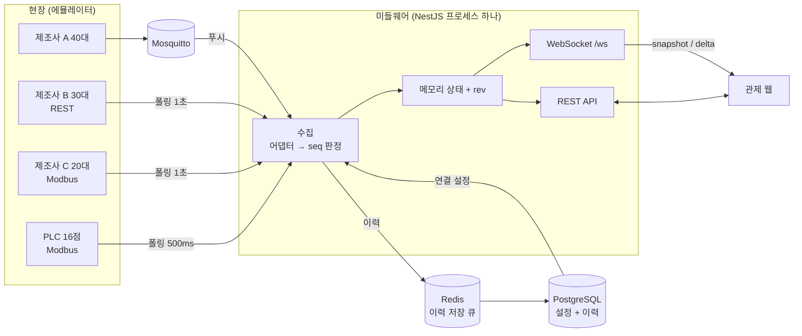
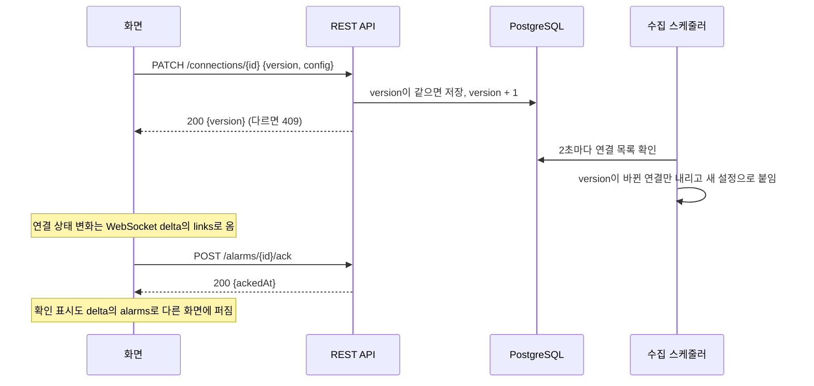
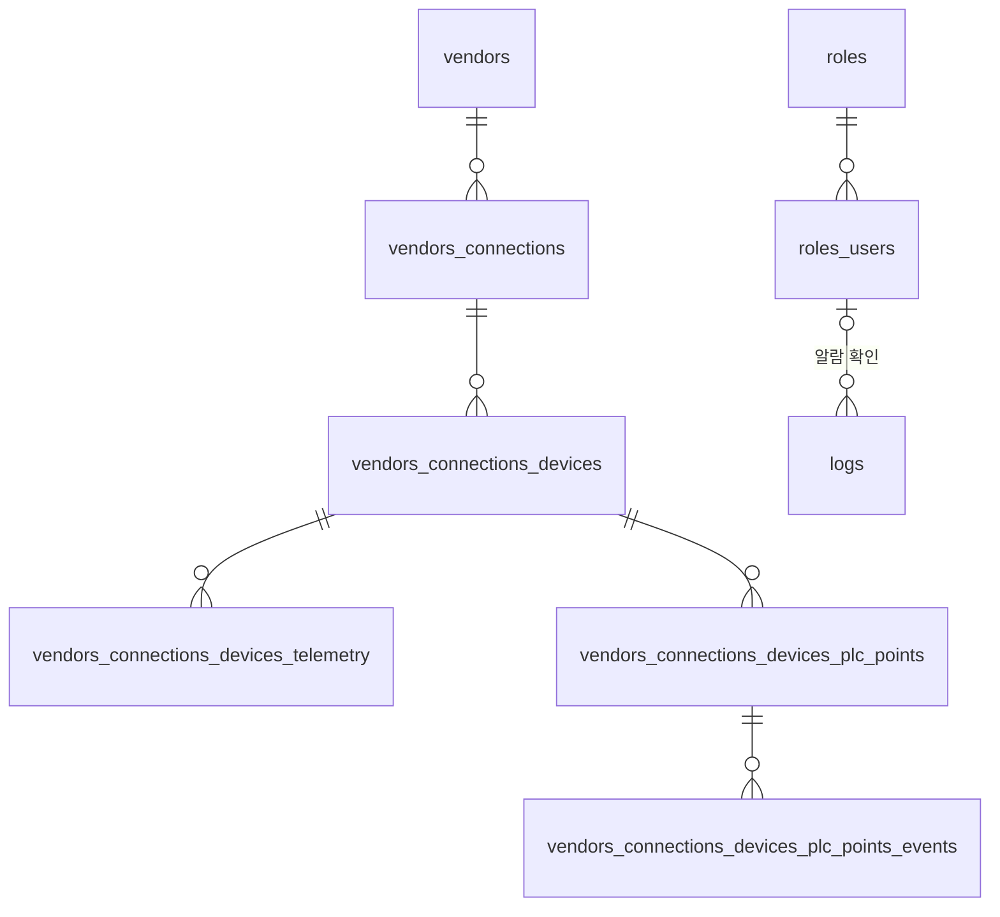
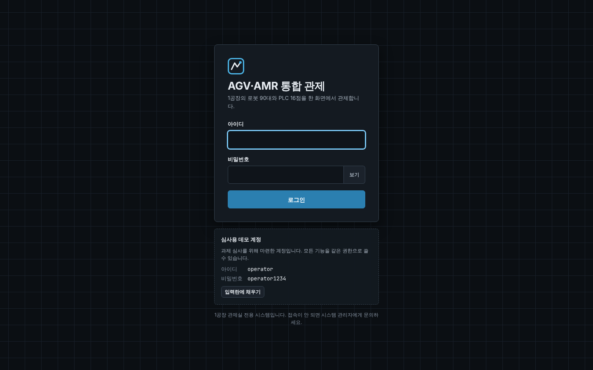
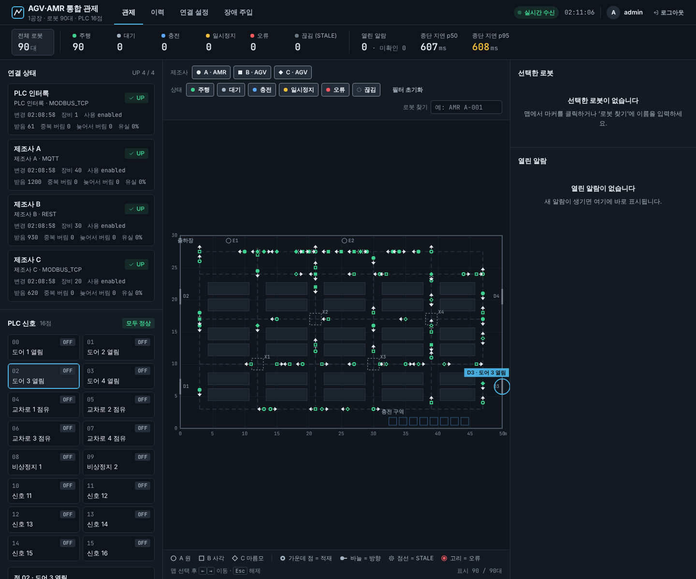
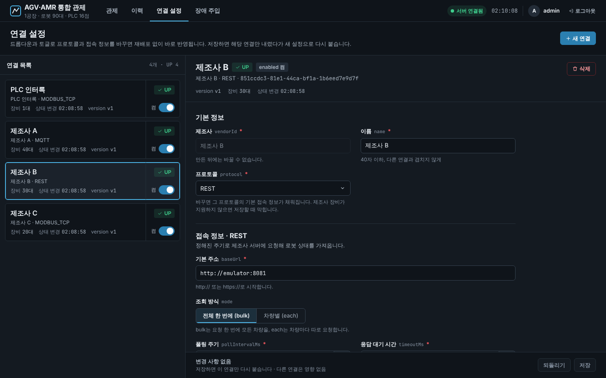
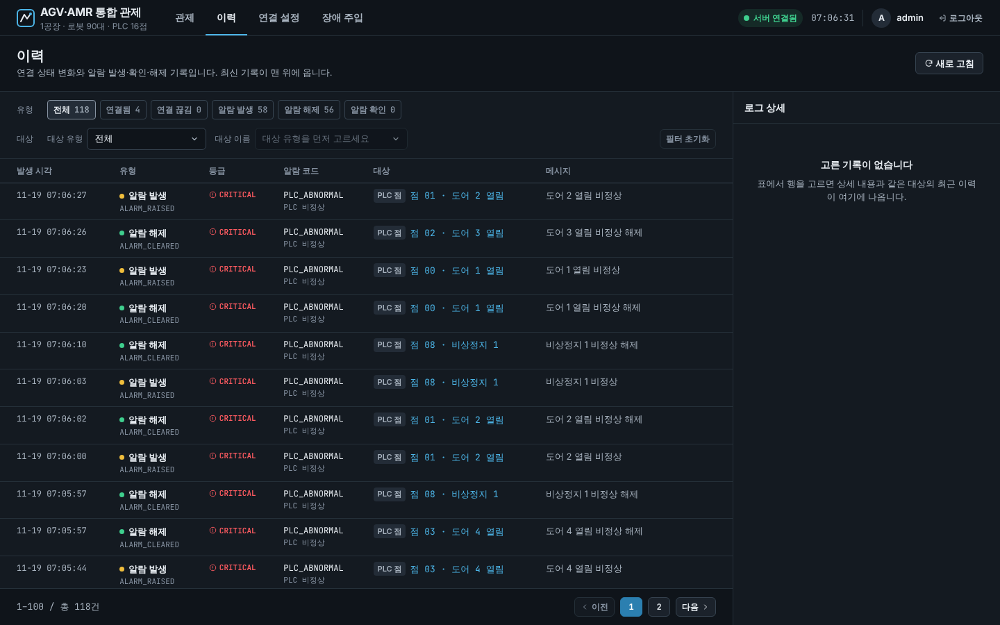
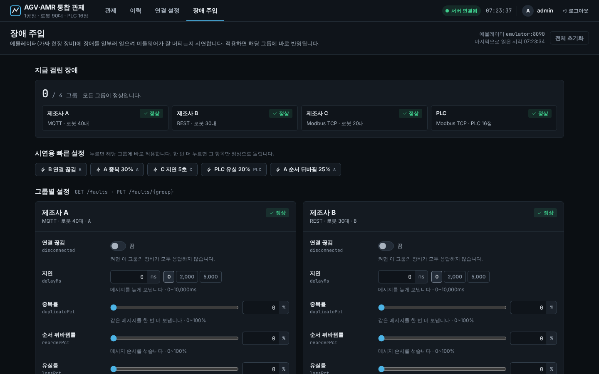

# 설계 문서: 멀티 프로토콜 AGV·AMR 통합 관제 미들웨어

「설계문서\_양식」의 목차를 따릅니다. 실행 방법은 [README](../README.md), API와 WebSocket 명세는 [인터페이스 명세](interface.md), 결정별 근거는 [설계 근거](design-rationale.md), 측정 원자료는 [측정 결과](measurements.md)에 있습니다.

## 1. 요약

**무엇을 만들었는가**

- 제조사마다 통신 방식이 다른 로봇 90대(MQTT, REST, Modbus TCP)와 PLC 16점을 공통 모델로 모아, 웹 화면에 WebSocket으로 실시간 전달하는 NestJS 미들웨어입니다.
- 연결 설정(프로토콜, 접속 정보, 켜고 끄기)은 DB에 있어서 API로 바꾸면 재배포 없이 그 연결만 다시 붙습니다.
- 현장을 대신하는 에뮬레이터가 90대와 PLC를 모사하고, 끊김·지연·중복·순서 뒤바뀜·유실을 주입합니다.

**핵심 설계 결정 3가지**

1. **어댑터 패턴**: 프로토콜 클라이언트(Repository)와 제조사 어댑터(Provider)를 나눴습니다. 기존 프로토콜을 쓰는 새 제조사는 어댑터 class 하나와 등록·상수 몇 줄, DB 행(제조사, 장비)으로 추가됩니다(4장 표).
2. **최신값 우선 + 두 구간의 순번**: 현장 → 미들웨어 구간은 장비별 `seq`로 중복과 늦게 온 메시지를 버리고, 미들웨어 → 화면 구간은 전역 `rev`와 서버 `epoch`로 재접속 때 바뀐 것만 이어받습니다.
3. **설정은 DB, 상태는 메모리, 이력은 큐를 거쳐 DB**: 실시간 경로에 DB와 브로커가 끼지 않아 DB가 멈춰도 화면은 멈추지 않습니다.

**달성한 수치** ([10장](#10-측정-결과))

- 종단 지연 p95 (5회 범위): MQTT 57~104ms, 폴링 연결(REST, Modbus) 146~964ms. 폴링 연결은 폴링 위상에 따라 실행마다 0~1초 사이에서 바뀝니다.
- 중복 30%·뒤바뀜 30% 주입에서 화면의 seq가 뒤로 간 횟수 0.
- 현장 연결 복구: 끊김을 풀고 0.2~2.1초, 에뮬레이터 컨테이너를 다시 켜고 1.1~5.0초 안에 새 데이터가 화면에 닿음.
- 화면 재접속 복구: 소켓을 연 뒤 첫 응답까지 4~9ms (같은 컴퓨터 기준).
- 미들웨어 CPU 평균 8~12%(코어 1개 기준), 메모리 169~175MB.

**달성하지 못한 것** ([12장](#12-한계와-다음-단계))

- 역할별 기능 차이, 이력 보관 기간 정리, 500대 부하 시험은 설계만 했습니다.

## 2. 문제 정의와 가정

**풀려는 문제**: 공장 한 곳에 제조사가 다른 로봇과 PLC가 섞여 있고, 제조사마다 통신 방식과 데이터 형식이 다릅니다. 운영자는 이 모두를 **한 화면에서 지금 상태 그대로** 보고, 연결이 바뀌어도 개발자 없이 화면에서 설정을 바꿀 수 있어야 합니다.

**사용자**: 관제실 운영자입니다. 로봇 위치와 상태, 연결 끊김, PLC 인터록 신호, 알람을 보고 확인합니다. 현장 연결 정보를 바꾸는 관리자도 같은 화면을 씁니다.

| 대상         | 수량 | 통신 방식           | 주기  | 미들웨어 입장 |
| ------------ | ---- | ------------------- | ----- | ------------- |
| 제조사 A AMR | 40대 | MQTT (JSON)         | 1초   | 구독 (푸시)   |
| 제조사 B AGV | 30대 | REST                | 1초   | 폴링          |
| 제조사 C AGV | 20대 | Modbus TCP 레지스터 | 1초   | 폴링          |
| PLC 인터록   | 16점 | Modbus TCP          | 500ms | 폴링          |

초당 들어오는 메시지는 약 122건(로봇 90건 + PLC 16점 × 초당 2회)입니다.

**직접 세운 가정**

| #   | 가정                                                                   | 근거                                                                                   |
| --- | ---------------------------------------------------------------------- | -------------------------------------------------------------------------------------- |
| A1  | 모든 원본 메시지는 장비별 순번(seq)과 발생 시각(ts)을 가진다           | 중복·순서 판정과 지연 측정에 둘 다 필요하다. Modbus는 레지스터에 담는다                |
| A2  | 로봇 상태는 최신값만 의미가 있다                                       | 관제 화면은 현재 위치를 본다. 늦게 온 과거 위치는 버려도 된다                          |
| A3  | PLC 신호와 알람은 변화 하나하나가 의미가 있다                          | 인터록 변화를 놓치면 안 되므로 상태가 아니라 이벤트로 저장한다                         |
| A4  | 제조사 B는 전체 차량 목록을 한 번에 주는 API를 가진다                  | 30대를 1초마다 따로 부르면 초당 30요청이다. 차량별 조회도 두고 설정(`mode`)으로 고른다 |
| A5  | 제조사 C는 Modbus 서버 1대에 차량 20대가 레지스터 블록으로 나뉘어 있다 | 집중형 컨트롤러 구조를 따랐다. 차량당 16레지스터                                       |
| A6  | 맵은 2D 평면 좌표(m)와 방향각 하나다                                   | 3D는 가점 항목이라 좌표 모델만 열어 둔다                                               |
| A7  | 운영자는 한 공장, 동시 접속 10명 이내다                                | 시나리오가 공장 1곳이다. 미들웨어를 단일 인스턴스로 두는 근거다                        |
| A8  | 에뮬레이터와 미들웨어는 같은 호스트 시계를 쓴다                        | docker compose 한 대에서 돌리므로 지연 측정에 시계 보정이 필요 없다                    |

## 3. 요구 사항

| 구분   | 요구 사항                                                      | 목표 수치                              | 달성 여부                                              |
| ------ | -------------------------------------------------------------- | -------------------------------------- | ------------------------------------------------------ |
| 기능   | 에뮬레이터: 90대와 PLC 모사, 끊김·지연·중복·뒤바뀜 주입        | 90대 + 16점, 장애 4종 이상             | 달성 (장애 주입 화면과 API, 유실까지 5종)              |
| 기능   | 어댑터 3종으로 공통 모델 정규화, 새 제조사 추가 범위 증명      | MQTT·REST·Modbus TCP                   | 달성 ([4장](#새-제조사를-추가할-때-바뀌는-범위))       |
| 기능   | 드롭다운·토글로 프로토콜과 접속 정보를 바꾸면 재배포 없이 변경 | 변경 후 수 초 안에 그 연결만 다시 붙음 | 달성: 연결 설정 화면과 API, 2초 주기로 반영            |
| 기능   | WebSocket 전달, 재접속 시 현재 상태 복구, 중복·순서 처리       | 재접속 후 바뀐 것만, 화면 seq 역행 0   | 달성                                                   |
| 기능   | 관제 UI: 맵 위 90대, 연결 상태, PLC, 장애 알림                 | 90대 실시간 표시                       | 달성: 관제 화면(Canvas 맵, 연결·PLC 패널, 알람 확인)   |
| 기능   | 측정: 지연 p50·p95, 유실률, 복구 시간, CPU·메모리              | 스크립트 한 번으로 4종                 | 달성 (`scripts/measure.mjs`)                           |
| 비기능 | 종단 지연                                                      | p95 1초 이내 (폴링 1초 주기 포함)      | 달성: 5회 중 가장 느린 p95 964ms (REST)                |
| 비기능 | 처리량                                                         | 초당 122건을 CPU 여유 있게             | 달성: CPU 평균 8~12%, 최대 18% (5회 범위)              |
| 비기능 | 현장 연결 복구                                                 | 끊김 해제 후 10초 안에 자동 복구       | 달성: 장애 해제 0.2~2.1초, 컨테이너 재시작 1.1~5.0초   |
| 비기능 | 화면 재접속 복구                                               | 1초 이내                               | 달성: 4~9ms (같은 컴퓨터 기준)                         |
| 비기능 | DB 장애 중 실시간 유지                                         | DB가 멈춰도 화면 갱신 계속             | 달성: 이력은 큐(Redis)에 쌓였다가 DB가 돌아오면 채워짐 |

## 4. 전체 아키텍처

### 구성도 (현장 → 수집 → 서버 → 화면)

### 데이터 흐름

1. Repository(MQTT·REST·Modbus 클라이언트)가 원본을 받습니다. MQTT는 수신 핸들러, REST·Modbus는 연결별 폴링 루프입니다.
2. 제조사 어댑터가 공통 모델(m, 도, %, ms)로 바꿉니다.
3. seq 판정이 중복과 늦게 온 메시지를 버리고, 받아들인 것만 메모리 상태에 반영하며 전역 rev를 올립니다.
4. 받아들인 것은 이력 저장 작업으로 Redis 큐에 넣고, 작업이 PostgreSQL에 묶어서 INSERT합니다.
5. WebSocket Gateway가 100ms마다 "화면이 본 rev 이후 바뀐 것"을 모아 보냅니다.
6. 상태 판정(STALE, 연결 DOWN, 알람)은 주기적으로 메모리 상태를 보고 바뀌면 rev를 올립니다. 그래서 같은 delta로 화면에 갑니다.

### 명령 흐름 (설정 변경과 알람 확인)

### 새 제조사를 추가할 때 바뀌는 범위

| 경우                           | 바뀌는 것                                                                                                                                                                                                                                                                                                                                             | 바뀌지 않는 것                                       |
| ------------------------------ | ----------------------------------------------------------------------------------------------------------------------------------------------------------------------------------------------------------------------------------------------------------------------------------------------------------------------------------------------------- | ---------------------------------------------------- |
| 기존 프로토콜을 쓰는 새 제조사 | 미들웨어: 어댑터 class 1개와 테스트, `ingest.module.ts` 등록 1줄, `connection.constants.ts`의 `VENDOR_PROTOCOLS` 1줄. 데이터: `vendors` 행 1개와 장비(`vendors_connections_devices`) 행(장비 등록 API가 없어 SQL·시드로 넣음). 웹: 맵 마커 모양을 정하는 `monitor.constants.ts`의 `VENDOR_KEY_BY_CODE` 1줄(없으면 A 모양으로 그려짐)                  | 프로토콜 클라이언트, seq 판정, 상태, 알람, WebSocket |
| 새 프로토콜을 쓰는 새 제조사   | 위에 더해 미들웨어: 클라이언트 Repository 1개, 접속 정보 DTO 1개와 `device-transport.types.ts`의 설정 타입, `CONNECTION_PROTOCOLS` 1줄, `device-transport.provider.ts`와 `ingest.service.ts`의 프로토콜 분기, `connections.service.ts`의 접속 정보 선택. 웹: 연결 설정 폼의 프로토콜 목록·입력 칸(`connections.constants.ts`, `connections.types.ts`) | seq 판정, 상태, 알람, WebSocket                      |

어댑터는 `VendorAdapter` 인터페이스(`toCommon(raw) → RobotReading[]`) 하나만 지키고, 미들웨어는 `vendors.code`로 어댑터를 찾습니다.

## 5. 구성 요소별 책임

| 구성 요소   | 책임                                                                  | 기술                                         | 선택 이유                                                                                                                |
| ----------- | --------------------------------------------------------------------- | -------------------------------------------- | ------------------------------------------------------------------------------------------------------------------------ |
| 에뮬레이터  | 로봇 90대와 PLC 16점 모사, 그룹별 장애 주입(`:8090/faults`)           | Node.js, TypeScript, mqtt.js, modbus-serial  | 미들웨어와 코드를 공유하지 않는 별도 프로세스라 실제 현장처럼 네트워크를 거친다                                          |
| MQTT 브로커 | 제조사 A 메시지 중계                                                  | Eclipse Mosquitto 2                          | 설정 파일 하나로 뜨고 가볍다                                                                                             |
| 미들웨어    | 수집, 공통 모델 변환, seq 판정, 상태, 알람, REST API, WebSocket, 측정 | NestJS 11, TypeScript strict                 | 과제 권장 스택. 모듈·DI로 계층을 강제하기 쉽다                                                                           |
| PostgreSQL  | 연결 설정과 이력(로봇 상태, PLC 변화, 로그)                           | PostgreSQL 16, Prisma 6                      | 설정과 이력을 한곳에. 접속 정보는 JSONB 한 칸                                                                            |
| Redis       | 이력 저장 작업 큐                                                     | Redis 7.4, BullMQ                            | DB가 멈춰도 이력이 쌓였다가 채워진다. 실시간 경로에는 넣지 않는다                                                        |
| 관제 웹     | 관제·이력·연결 설정 화면, WebSocket 수신과 재접속, 브라우저 종단 지연 | React 19, Vite, TypeScript, Canvas 2D, nginx | 90개 마커를 초당 10회 그리는 데 Canvas가 DOM보다 가볍다. nginx가 `/api`, `/ws`를 미들웨어로 넘겨 주소 하나(:8080)로 쓴다 |

미들웨어 내부는 4계층이고 각 계층은 바로 아래 계층만 부릅니다.

| 계층       | 하는 일                      | 이 프로젝트의 class                                                         |
| ---------- | ---------------------------- | --------------------------------------------------------------------------- |
| Controller | 요청을 받아 Service를 부른다 | REST Controller, WebSocket Gateway, 수집·알람 스케줄러                      |
| Service    | 업무 규칙                    | 수집, 연결 설정, 실시간 전달, 알람, 조회, 측정                              |
| Provider   | Repository 조합, 격리된 로직 | 제조사 어댑터 4종, seq 판정, STALE 판정, 연결 상태, 알람 판정, 이력 큐 넣기 |
| Repository | 원천 데이터                  | MQTT·REST·Modbus 클라이언트, Prisma 저장소, 메모리 상태 저장소              |

## 6. 데이터 모델과 메시지 스키마

### 공통 데이터 모델

| 모델      | 필드                                                                                                                    |
| --------- | ----------------------------------------------------------------------------------------------------------------------- |
| 로봇 상태 | `seq`, `sourceTs`, `receivedTs`, `x`, `y`(m), `theta`(도), `speed`(m/s), `batteryPct`, `opState`, `errorCode`, `loaded` |
| PLC 점    | `pointNo`(0~15), `value`, `normalValue`, `abnormal`, `changedAt`, `stale`                                               |
| 연결 상태 | `connectionId`, `status`(UNKNOWN, UP, DOWN), `changedAt`                                                                |
| 알람      | `code`, `level`, `targetType`, `targetId`, `message`, `raisedAt`, `ackedAt`                                             |

`opState`는 `IDLE`, `MOVING`, `CHARGING`, `PAUSED`, `ERROR`입니다. 모든 엔티티는 바뀔 때 받은 전역 `rev`를 함께 가집니다. `stale`은 원본에 없는 값이라 미들웨어가 판정합니다(로봇 3초, PLC 1.5초 무소식, 또는 연결 DOWN, 또는 로봇 지연 3초 초과).

### 프로토콜별 매핑표

| 공통 필드  | A: MQTT JSON                                    | B: REST JSON                         | C: Modbus 레지스터 (차량 n의 시작 = 100 + 16n) |
| ---------- | ----------------------------------------------- | ------------------------------------ | ---------------------------------------------- |
| 장비 식별  | 토픽 `vendorA/amr/{serial}/state`               | `vehicleId`                          | 블록 번호 n                                    |
| seq        | `seq`                                           | `sequence`                           | +0, +1 (uint32)                                |
| sourceTs   | `ts` (ISO 8601)                                 | `timestamp` (epoch ms)               | +2 ~ +4 (uint48, ms)                           |
| x, y       | `pose.x`, `pose.y` (m)                          | `position.xMm`, `yMm` (mm → ÷1000)   | +5, +6 (int16, cm → ÷100)                      |
| theta      | `pose.theta` (rad → 도)                         | `headingDeg` (도, 0~360으로 정규화)  | +7 (uint16, 0.1도 → ÷10)                       |
| speed      | `velocity` (m/s)                                | `speedMmS` (mm/s → ÷1000)            | +8 (uint16, cm/s → ÷100)                       |
| batteryPct | `battery.soc` (0~1 → ×100)                      | `batteryLevel` (0~100)               | +9 (uint16, %)                                 |
| opState    | `mode` (idle, driving, charging, paused, fault) | `status` (IDLE, RUN, CHG, STOP, ERR) | +10 (0~4)                                      |
| errorCode  | `fault.code` (없으면 null)                      | `errorCode` (빈 문자열이면 null)     | +11 (0이면 null)                               |
| loaded     | `payload.loaded`                                | `hasLoad`                            | +12 비트 0                                     |

PLC는 입력 레지스터 0의 비트 0~15에 16점, 1~2에 seq(uint32), 3~5에 발생 시각(uint48 ms)을 담습니다. 값과 seq를 한 요청으로 읽어야 어긋나지 않아서 코일 16개가 아니라 워드 하나에 담았습니다. 제조사 C는 Modbus 한 요청 상한(125레지스터) 안에서 블록을 나눠 읽습니다.

### 저장 구조와 보관 정책

| 묶음 | 테이블                                                                                                                           | 쓰는 시점                                    |
| ---- | -------------------------------------------------------------------------------------------------------------------------------- | -------------------------------------------- |
| 설정 | `vendors`, `vendors_connections`(config JSONB, version), `vendors_connections_devices`, `..._plc_points`, `roles`, `roles_users` | 시드와 연결 설정 API                         |
| 이력 | `vendors_connections_devices_telemetry`                                                                                          | 받아들인 로봇 상태마다 한 행 (초당 90행)     |
| 이력 | `vendors_connections_devices_plc_points_events`                                                                                  | PLC 점의 값이 바뀐 순간에만                  |
| 이력 | `logs`                                                                                                                           | 연결 UP·DOWN, 알람 발생·해제·확인. 추가만 함 |

- 현재 상태 테이블은 없습니다. 현재 상태는 메모리에 있고, 재시작하면 장비별 마지막 이력 행으로 되살립니다.
- 테이블과 외래키 이름은 부모 사슬 전체를 붙이고, 상태 값 컬럼은 enum 대신 varchar입니다([설계 근거 11·12장](design-rationale.md)).
- 보관 정책(설계만, 구현하지 않음): telemetry는 24시간(하루 약 780만 행, 1시간마다 오래된 행 삭제), PLC 이벤트와 logs는 30일. 맵은 공장이 한 곳이라 DB가 아닌 코드 설정, 장애 주입 설정은 에뮬레이터 메모리에만 둡니다.

## 7. 인터페이스 명세

전체 명세는 [인터페이스 명세](interface.md)에 있습니다. 여기에는 요점만 적습니다.

**REST API**: 18개 엔드포인트. 모든 응답은 `{ success, data, error }`이고, 오류는 400(검증), 401(인증), 404(없음), 409(version 충돌, 이름 중복, 장비가 딸린 연결 삭제)입니다.

**WebSocket 이벤트** (`ws://localhost:3000/ws`, `{ event, data }` JSON)

| 이벤트          | 방향        | 페이로드                                                 | 순서 보장 방식                               |
| --------------- | ----------- | -------------------------------------------------------- | -------------------------------------------- |
| `hello`         | 화면 → 서버 | `token`, `epoch?`, `lastRev?`                            | 같은 epoch면 lastRev 이후만, 아니면 snapshot |
| `snapshot`      | 서버 → 화면 | `epoch`, `rev`, `robots`, `plcPoints`, `links`, `alarms` | 이 rev가 화면의 기준점                       |
| `delta`         | 서버 → 화면 | `fromRev`, `rev`, 바뀐 엔티티, `removed`                 | `fromRev`가 내 rev와 같을 때만 반영          |
| `resync`        | 화면 → 서버 | `lastRev`                                                | 중간을 놓쳤을 때 lastRev 이후를 다시 받음    |
| `ping` / `pong` | 양방향      | `t`                                                      | 5초 주기, 2번 연속 무응답이면 끊김           |
| `error`         | 서버 → 화면 | `message`                                                | 토큰 오류, 형식 오류                         |

**인증·권한**: `POST /auth/login`(데모 계정 viewer, operator, admin)으로 JWT를 받아 `Authorization: Bearer`로 보냅니다. WebSocket은 `hello.token`으로 검증합니다. `/health`, `/auth/login`만 예외입니다. 역할(VIEWER, OPERATOR, ADMIN)에 따른 기능 차이는 과제 요구에 없어서 두지 않았고, 설계만 [설계 근거 16장](design-rationale.md#16-로그인은-구현-역할별-기능-차이는-설계만)에 남겼습니다.

## 8. 장애 시나리오

검증 수치는 `scripts/measure.mjs`([측정 결과](measurements.md))와 docker compose에서 직접 재현한 결과입니다.

| 상황               | 감지 방법                                                    | 대응                                                                   | 복구 절차                                                                         | 검증 방법·결과                                                                                                              |
| ------------------ | ------------------------------------------------------------ | ---------------------------------------------------------------------- | --------------------------------------------------------------------------------- | --------------------------------------------------------------------------------------------------------------------------- |
| 연결 끊김          | MQTT 연결 종료 또는 3초 수신 없음, REST·Modbus 3회 연속 실패 | 연결 DOWN, 소속 장비 STALE, `LINK_DOWN` 로그, DEVICE_STALE 알람        | 1초에서 10초까지 늘어나는 간격으로 재접속. 붙으면 UP, 알람 해제                   | 장애 주입 끊김(5회): DOWN 감지 2.1~5.0초, 해제 후 화면에 새 데이터까지 0.18~2.06초. 에뮬레이터 컨테이너 재시작: 1.07~4.97초 |
| 메시지 중복        | seq = 마지막                                                 | 버림. 이력에도 넣지 않음                                               | 필요 없음                                                                         | A에 중복 30% 주입(5회): 받은 664~697건 중 중복 122~145건을 버림                                                             |
| 순서 뒤바뀜        | seq < 마지막 (sourceTs가 5초 이상 앞서면 장비 재시작으로 봄) | 버림                                                                   | 필요 없음                                                                         | A에 뒤바뀜 30% 주입(5회): 늦게 온 99~123건을 버림, 화면에서 seq가 뒤로 간 횟수 0                                            |
| 지연               | 수신 시각 - 발생 시각 > 3초                                  | 장비 STALE 표시                                                        | 새 데이터가 제때 오면 해제                                                        | C에 지연 5초 주입: 연결은 UP, C 20대 STALE                                                                                  |
| 서버 재시작        | 화면이 소켓 종료 감지                                        | 화면은 마지막 상태 유지                                                | 서버가 이력의 마지막 행으로 상태를 되살리고 새 epoch. 화면은 snapshot을 새로 받음 | `restart middleware`: 로봇 90대·PLC 16점 복구, 다시 응답까지 약 4.4초(마이그레이션·시드 포함)                               |
| 화면 네트워크 끊김 | ping 2회 무응답                                              | 접속 끊음                                                              | `hello`에 epoch, lastRev를 보내 그 뒤 바뀐 것만 받음                              | 재접속 후 첫 응답까지 4~9ms (같은 컴퓨터 기준)                                                                              |
| DB 장애            | 이력 저장 작업 실패                                          | 실시간 전달은 계속. 작업은 Redis에 남아 2초 간격으로 재시도(최대 30분) | DB가 돌아오면 밀린 이력이 차례로 들어감                                           | PostgreSQL 20초 정지: 그동안 화면 seq 계속 증가, 복구 후 그 구간 이력이 빠짐없이 채워짐                                     |
| Redis 장애         | 큐 넣기 실패                                                 | 실시간 전달은 계속. 그 동안의 이력은 버림                              | Redis가 돌아오면 다음 이력부터 저장                                               | 코드 경로로 확인(`enableOfflineQueue: false`). 수치는 재지 않음                                                             |

## 9. UI 설계

로그인, 관제, 이력, 연결 설정, 장애 주입 다섯 화면을 모두 구현했습니다. 관제 웹은 http://localhost:8080 입니다.

### 화면 목록

| 화면      | 목적                                                                  |
| --------- | --------------------------------------------------------------------- |
| 로그인    | 데모 계정으로 들어가 토큰을 받음                                      |
| 관제      | 맵 위 90대 위치·상태, 연결 상태, PLC 16점, 열린 알람을 한 화면에서 봄 |
| 이력      | 연결 끊김·복구와 알람 발생·해제·확인 기록을 유형·대상으로 조회        |
| 연결 설정 | 드롭다운·토글로 프로토콜과 접속 정보를 바꾸고 결과(UP, 409, 400)를 봄 |
| 장애 주입 | 그룹(A, B, C, PLC)별 끊김·지연·중복·뒤바뀜·유실을 켜고 끔             |

### 화면 이미지

로그인 화면: 아이디와 비밀번호 입력, 심사용 데모 계정을 입력란에 채우는 버튼

관제 화면: 맵 위 90대(제조사별 모양, 방향 바늘, 적재 점), 상단 상태 요약과 브라우저 종단 지연, 왼쪽 연결 상태와 PLC 16점, 오른쪽 선택한 로봇과 열린 알람

연결 설정 화면: 연결 목록과 켬·끔 토글, 프로토콜별 접속 정보 입력과 허용 범위, 저장하면 그 연결만 다시 붙음

이력 화면: 유형별 건수, 대상 필터, 행을 고르면 같은 대상의 최근 이력

장애 주입 화면: 지금 걸린 장애 요약, 시연용 빠른 설정(누르면 바로 적용, 다시 누르면 해제), 그룹별 끊김·지연·중복·뒤바뀜·유실 입력

### 주요 사용자 흐름

1. **이상 발견**: 관제 화면에서 알람이 뜸 → 알람을 눌러 맵에서 해당 로봇·PLC 점을 찾음 → 확인을 누름(다른 화면에도 확인 표시가 퍼짐).
2. **연결 변경**: 연결 설정에서 연결을 고르고 포트나 주기를 바꿈 → 저장 → 몇 초 안에 연결 상태가 UP으로 돌아오는지 봄. 다른 사람이 먼저 고쳤으면 409 안내 후 새로 불러옴.
3. **장애 재현**: 장애 주입에서 그룹 하나를 끊음 → 관제 화면에서 그 연결이 DOWN, 로봇이 STALE로 바뀌는 것을 봄 → 끊김을 풀고 복구를 봄.

### 상태 정의

| 상태      | 조건                                                          | 화면 표시 (디자인 기준)                                          |
| --------- | ------------------------------------------------------------- | ---------------------------------------------------------------- |
| 정상      | 연결 UP, 장비 `stale=false`, `opState≠ERROR`, 열린 알람 없음  | 제조사별 마커(A 원, B 사각, C 마름모), 방향 바늘, 적재 점        |
| 경고      | WARN 알람 열림(LOW_BATTERY, DEVICE_STALE), 장비 STALE         | STALE은 점선 테두리, 알람 목록에 경고 표시                       |
| 장애      | CRITICAL 알람 열림(ROBOT_ERROR, PLC_ABNORMAL), 연결 DOWN      | 오류 고리, 연결 상태 DOWN 표시                                   |
| 연결 끊김 | 화면과 서버 사이 WebSocket이 끊김(ping 2회 무응답, 소켓 종료) | "서버 연결 끊김" 표시, 마지막 상태를 흐리게 유지, 재접속 후 복구 |

## 10. 측정 결과

**환경**: 리눅스 컨테이너(CPU 4개) 한 대의 docker compose(미들웨어, 에뮬레이터, PostgreSQL, Redis, Mosquitto), 로봇 90대와 PLC 16점. **방법**: `node scripts/measure.mjs` 한 번으로 정상 30초, 장애 주입, 끊김 복구, 재접속 복구, 에뮬레이터 컨테이너 재시작 복구를 차례로 잽니다. 이것을 다섯 번 돌려 범위(최소~최대)로 적었습니다. 종단 지연은 스크립트의 WebSocket 클라이언트가 delta를 받은 시각에서 장비 발생 시각을 뺀 값입니다. 원자료와 읽는 법은 [측정 결과](measurements.md)에 있습니다.

| 지표                | 조건                                    | 결과 (5회 범위)                                                                               |
| ------------------- | --------------------------------------- | --------------------------------------------------------------------------------------------- |
| 종단 지연 p95       | 정상 30초                               | A(MQTT) 57~104ms, B(REST) 146~964ms, C(Modbus) 239~825ms, PLC 154~524ms                       |
| 건너뛴 seq          | 정상 30초                               | 대부분 0%. 폴링 위상이 갱신 경계에 걸린 1회에서 B 3.23%, PLC 1.64% (폴링이 상태 하나를 못 봄) |
| 반영 못 한 seq      | A에 중복 30%, 뒤바뀜 30%, 유실 10% 주입 | 23.3~26.7%. 그중 끝내 오지 않은 것은 하한 19~42건, 나머지는 늦게 와서 버림. 화면 seq 역행 0   |
| 종단 지연 p50 / p95 | 브라우저(관제 화면 상단 요약), 정상 1분 | 161 / 262ms (1회, STALE이 아닌 로봇 90대 각각의 최근 지연)                                    |
| 복구 시간           | 현장 연결 끊김 해제 → 화면에 새 데이터  | A 0.18~1.07s, B 0.98~1.08s, C 1.77~1.86s, PLC 1.86~2.06s                                      |
| 복구 시간           | 에뮬레이터 컨테이너 재시작 → 새 데이터  | 1.07~4.97s (부팅 포함, 네 연결 모두)                                                          |
| 복구 시간           | 화면 재접속 → 첫 응답                   | 4~9ms (같은 컴퓨터 기준, 끊김을 알아채는 시간은 빠짐)                                         |
| CPU / 메모리        | 정상 30초, 5초 간격 표본                | CPU 평균 8.3~11.9% 최대 18.4% (코어 1개 기준), RSS 169~175MB                                  |

폴링 방식(B, C, PLC)은 데이터가 생긴 뒤 다음 폴링까지 기다리므로 지연이 0~폴링 주기(1초, PLC는 0.5초)만큼 더 나옵니다. 에뮬레이터 갱신과 폴링이 같은 1초 주기라 한 번 띄운 동안에는 기다리는 시간이 거의 고정되고, 다시 띄울 때마다 바뀝니다. 그래서 한 번 잰 p95가 아니라 다섯 번의 범위로 적었고, B와 C 중 어느 쪽이 빠른지는 실행마다 다릅니다. Mac의 Docker Desktop에서 재면 스크립트와 에뮬레이터의 시계가 달라 종단 지연에 시계 차가 섞일 수 있습니다.

## 11. 트레이드오프와 대안

결정 16개의 전체 비교는 [설계 근거](design-rationale.md)에 있습니다. 면접에서 가장 많이 물을 만한 것만 옮깁니다.

| 결정                                            | 검토한 대안                 | 선택 이유                                                          | 감수한 단점                                                |
| ----------------------------------------------- | --------------------------- | ------------------------------------------------------------------ | ---------------------------------------------------------- |
| 미들웨어 한 프로세스, 실시간 경로에 브로커 없음 | Redis Streams, NATS, Kafka  | 초당 122건은 한 프로세스로 충분. 장애 지점이 줄어든다              | 서버를 여러 대로 늘릴 수 없다 (확장 방향은 설계 근거 14장) |
| 늦게 온 메시지를 버림 (최신값 우선)             | 모았다가 순서대로 재정렬    | 관제는 현재 상태를 본다. 재정렬 버퍼는 모든 메시지에 지연을 더한다 | 늦게 온 위치는 이력에서도 빠진다                           |
| 전역 rev와 epoch로 재접속 복구                  | 이벤트 로그와 오프셋 재전송 | 버퍼가 없고 snapshot과 이어받기가 같은 코드다                      | 끊긴 동안의 중간 경로는 화면이 받지 못한다                 |
| 100ms 묶음 전송                                 | 메시지마다 즉시 전송        | 초당 10프레임으로 고정되어 장비가 늘어도 화면 부하가 일정          | 지연이 최대 100ms 늘어난다                                 |
| 연결 설정은 DB, 2초마다 맞춤                    | API가 수집을 직접 재시작    | 모듈·계층 경계를 지키고 재시작해도 DB가 기준                       | 반영까지 최대 2초                                          |
| 이력 저장만 Redis 큐                            | 건별 INSERT, 메모리 대기열  | DB가 멈춰도 이력이 쌓였다가 채워진다                               | Redis가 멈추면 그동안 이력이 빠진다                        |
| WebSocket                                       | SSE                         | 과제 요구. hello, resync, ping을 같은 연결로                       | 재접속과 생존 확인을 직접 구현했다                         |

## 12. 한계와 다음 단계

**구현하지 못한 것과 이유**

- 역할별 기능 차이: 과제 요구에 없어 설계만 했습니다. 지금은 로그인한 사용자라면 누구나 연결 설정을 바꿀 수 있습니다.
- 이력 보관 기간 정리: telemetry가 하루 약 780만 행 쌓이지만 오래된 행을 지우는 작업은 없습니다.
- 가점 항목(3D, 500대 이상 부하 시험, 인터록 제어, VDA 5050): 필수 항목에 시간을 먼저 썼습니다.

**설계상 알려진 한계**

- 미들웨어가 한 대라 그 프로세스가 죽으면 재시작(약 4초)까지 수집과 전달이 멈춥니다.
- PLC는 500ms 폴링이라 그보다 짧은 펄스는 잡지 못합니다.
- 알람은 메모리에 있어서 서버를 재시작하면 확인(ack) 표시가 사라지고 다시 열린 알람은 미확인입니다. 확인 기록은 logs에 남습니다.
- 화면 재접속 때 끊긴 동안의 중간 경로는 다시 보내지 않습니다.

**시간이 더 있다면 (우선순위 순)**

1. 역할 가드(`@Roles`)와 연결 설정 변경 감사 로그
2. telemetry 보관 정책(1시간마다 24시간 지난 행 삭제, 일 단위 파티셔닝)
3. 500대 부하 시험과 병목 분석(이력 묶음 크기, delta 직렬화 비용)
4. 다중 서버: 수집 뒤 외부 큐, 상태와 rev를 Redis로([설계 근거 14장](design-rationale.md#14-스케일-아웃할-때의-확장-방향-구현하지-않음))

## 13. AI 활용 내역

| 사용한 도구             | 맡긴 작업                                                                                              |
| ----------------------- | ------------------------------------------------------------------------------------------------------ |
| Claude Code (설계 단계) | 과제 분석, 설계 초안(아키텍처, 스키마, 장애 시나리오, 구현 순서)                                       |
| Claude Code (구현 단계) | API 단위로 나눈 조각별 구현, PR 작성과 셀프 리뷰, README·설계 문서·인터페이스 명세 작성, 측정 스크립트 |

**본인이 정하고 검증·수정한 것**

- 설계: 아키텍처, 4계층 규칙, 테이블 이름 규칙, 현재 상태 테이블을 두지 않는 것, WebSocket 유지, 역할별 기능 차이 제외 등 주요 결정을 항목별로 검토하고 확정했습니다.
- 코드 규칙: 레이어 참조 규칙, 파일당 class 하나, DTO 분리, `ApiResult` 공통 응답, enum 대신 varchar, `@nestjs/config`·`@nestjs/schedule` 사용, 스프레드와 `let` 지양 등을 직접 정했고, 규칙이 생길 때마다 이미 병합된 코드에도 소급 적용하게 했습니다.
- 작업 방식: 조각 하나를 PR 하나(약 10파일, 300줄 이하)로 나누고 merge commit으로 병합해 작업 과정이 커밋에 남게 했습니다. 병합된 PR을 보고 고칠 점을 지시해 별도 PR로 반영했습니다.

## 14. 실행 방법

자세한 명령은 [README](../README.md)에 있습니다.

- **사전 준비**: Docker와 Docker Compose. 로컬 개발은 Node.js 22, pnpm 10.
- **실행 명령**: `docker compose up --build` 한 번으로 PostgreSQL, Redis, Mosquitto, 에뮬레이터, 미들웨어가 뜨고, 미들웨어가 테이블과 데모 데이터를 만듭니다.
- **데모 계정**: `viewer/viewer1234`, `operator/operator1234`, `admin/admin1234` (역할별 기능 차이 없음)
- **장애 주입**: `PUT http://localhost:8090/faults/{A|B|C|PLC}`에 `disconnected`, `delayMs`, `duplicatePct`, `reorderPct`, `lossPct`를 보냅니다. 컨테이너 단위로는 `docker compose stop emulator`, `docker compose restart middleware`, `docker compose stop postgres`.
- **측정**: `node scripts/measure.mjs`
