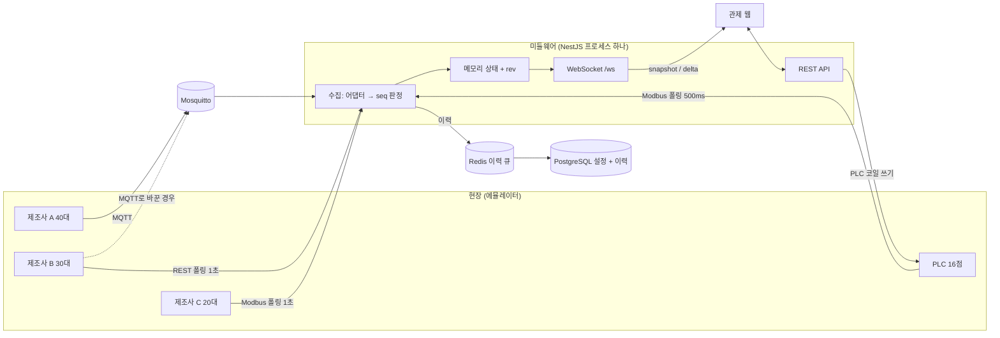
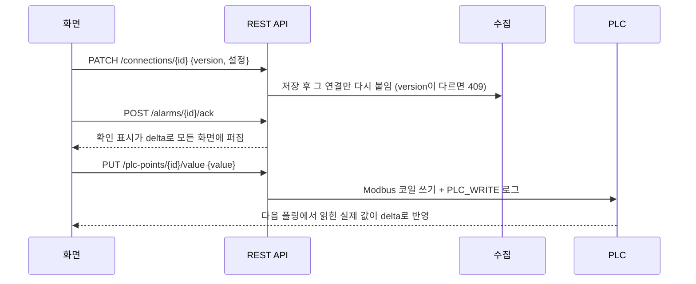

# 설계 문서: 멀티 프로토콜 AGV·AMR 통합 관제 미들웨어

「설계문서\_양식」의 목차를 따릅니다. 세부는 [인터페이스 명세](interface.md), [설계 근거](design-rationale.md), [측정 결과](measurements.md), [README](../README.md)에 있습니다.

## 1. 요약

**무엇을 만들었는가**

- NestJS로 만든 미들웨어입니다. 통신 방식이 다른 로봇 90대(MQTT, REST, Modbus TCP)와 PLC 16점을 공통 모델로 모아 관제 웹에 WebSocket으로 실시간 전달합니다.
- 연결 설정은 DB에 있어, 화면에서 프로토콜이나 접속 정보를 바꿔 저장하면 재배포 없이 그 연결만 바로 다시 붙습니다.
- 현장 대신 에뮬레이터가 90대와 PLC를 모사하고 끊김·지연·중복·순서 뒤바뀜·유실을 주입합니다.

**핵심 설계 결정 3가지**

1. **어댑터 패턴**: 프로토콜 클라이언트와 제조사 어댑터를 나눠, 새 제조사는 어댑터 class 하나와 상수·DB 행 몇 개로 붙습니다(4장).
2. **최신값 우선 + 두 구간의 순번**: 현장 구간은 장비별 `seq`로 중복과 늦은 메시지를 버리고, 화면 구간은 전역 `rev`와 `epoch`로 재접속 때 바뀐 것만 보냅니다.
3. **설정은 DB, 상태는 메모리, 이력은 큐를 거쳐 DB**: 실시간 경로에 DB가 없어 DB가 멈춰도 화면은 계속 갱신됩니다.

**달성한 수치 / 달성하지 못한 것**

- 종단 지연 p95: MQTT 57~104ms, 폴링 연결 146~964ms(목표 1초 이내). 현장 연결 복구 0.2~2.1초(목표 10초). CPU 평균 8~12%.
- 중복 30%·뒤바뀜 30% 주입에서 화면 seq 역행 0. DB 20초 정지 중에도 화면 갱신 유지.
- 하지 못한 것: 역할별 기능 차이(설계만), 가점 중 3D 화면·500대 부하 시험·VDA 5050.

## 2. 문제 정의와 가정

**풀려는 문제와 사용자**: 공장 한 곳에 제조사마다 통신 방식과 데이터 형식이 다른 로봇과 PLC가 섞여 있습니다. 관제실 운영자는 이 모두를 한 화면에서 지금 상태 그대로 보고, 연결이 바뀌어도 개발자 없이 화면에서 설정을 바꿀 수 있어야 합니다.

| 대상         | 수량 | 통신 방식             | 주기  | 미들웨어 입장   |
| ------------ | ---- | --------------------- | ----- | --------------- |
| 제조사 A AMR | 40대 | MQTT (JSON)           | 1초   | 구독            |
| 제조사 B AGV | 30대 | REST 또는 MQTT (JSON) | 1초   | 폴링 또는 구독  |
| 제조사 C AGV | 20대 | Modbus TCP 레지스터   | 1초   | 폴링            |
| PLC 인터록   | 16점 | Modbus TCP            | 500ms | 폴링, 코일 쓰기 |

초당 약 122건(로봇 90건 + PLC 16점 × 2회)이 들어옵니다.

**직접 세운 가정과 근거**

| #   | 가정                                                                     | 근거                                                                    |
| --- | ------------------------------------------------------------------------ | ----------------------------------------------------------------------- |
| A1  | 모든 원본 메시지에는 장비별 순번(seq)과 발생 시각이 들어 있습니다        | 중복·순서 판정과 지연 측정에 필요합니다. Modbus는 레지스터에 담습니다   |
| A2  | 로봇 상태는 최신값만 의미가 있습니다                                     | 관제는 현재 위치를 봅니다. 늦게 온 과거 위치는 버립니다                 |
| A3  | PLC 신호와 알람은 변화 하나하나가 의미가 있습니다                        | 인터록 변화를 놓치지 않도록 이벤트로 저장합니다                         |
| A4  | 제조사 B는 전체 목록 API를 주고, 같은 상태를 MQTT로도 발행할 수 있습니다 | 30대를 따로 부르면 초당 30요청입니다. MQTT는 프로토콜 전환 시연용입니다 |
| A5  | 제조사 C는 Modbus 서버 1대에 20대가 블록으로 나뉘어 있습니다             | 집중형 컨트롤러 구조입니다. 차량당 16레지스터를 씁니다                  |
| A6  | 운영자는 한 공장, 동시 접속 10명 이내입니다                              | 미들웨어를 단일 인스턴스로 두는 근거입니다                              |
| A7  | 에뮬레이터와 미들웨어는 같은 호스트 시계를 씁니다                        | docker compose 한 대라 지연 측정에 시계 보정이 필요 없습니다            |

## 3. 요구 사항

| 구분   | 요구 사항                                                 | 목표 수치                           | 달성 여부                                         |
| ------ | --------------------------------------------------------- | ----------------------------------- | ------------------------------------------------- |
| 기능   | 에뮬레이터: 90대 + PLC 16점, 장애 주입                    | 장애 4종 이상                       | 달성: 5종(끊김·지연·중복·뒤바뀜·유실), 화면과 API |
| 기능   | 어댑터 3종으로 공통 모델 정규화, 새 제조사 추가 범위 증명 | MQTT·REST·Modbus TCP                | 달성 (4장 표)                                     |
| 기능   | 화면에서 프로토콜·접속 정보 변경, 재배포 없음             | 저장 후 수 초 안에 그 연결만 재접속 | 달성: 저장하면 바로 반영, B는 REST ↔ MQTT 전환   |
| 기능   | WebSocket 전달, 재접속 복구, 중복·순서 처리               | 화면 seq 역행 0                     | 달성                                              |
| 기능   | 관제 UI: 맵 위 90대, 연결 상태, PLC, 장애 알림            | 90대 실시간 표시                    | 달성                                              |
| 기능   | 측정: 지연 p50·p95, 유실률, 복구 시간, CPU·메모리         | 스크립트 한 번                      | 달성 (`scripts/measure.mjs`)                      |
| 가점   | PLC 신호 인터록 제어                                      | 화면에서 PLC 점 쓰기                | 달성: Modbus 코일 쓰기, 쓴 기록을 이력에 남김     |
| 비기능 | 종단 지연                                                 | p95 1초 이내                        | 달성: 가장 느린 p95 964ms (REST, 5회 중)          |
| 비기능 | 처리량                                                    | 초당 122건, CPU 여유                | 달성: CPU 평균 8~12%, 최대 18%                    |
| 비기능 | 현장 연결 복구                                            | 10초 이내 자동 복구                 | 달성: 0.2~2.1초, 에뮬레이터 재시작 1.1~5.0초      |
| 비기능 | 화면 재접속 복구                                          | 1초 이내                            | 달성: 4~9ms (같은 컴퓨터 기준)                    |
| 비기능 | DB 장애 중 실시간 유지                                    | 화면 갱신 계속                      | 달성: 이력은 Redis 큐에 쌓였다가 채워짐           |

## 4. 전체 아키텍처

**구성도 (현장 → 수집 → 서버 → 화면)**

**데이터 흐름**

1. 프로토콜 클라이언트가 원본을 받고(MQTT 구독, REST·Modbus 폴링), 제조사 어댑터가 공통 모델(m, 도, %, ms)로 바꿉니다.
2. seq 판정이 중복과 늦은 메시지를 버리고, 받아들인 것만 메모리 상태에 반영하며 전역 rev를 올립니다.
3. 받아들인 것은 Redis 큐를 거쳐 PostgreSQL에 묶어서 저장합니다.
4. WebSocket이 100ms마다 화면이 본 rev 이후 바뀐 것만 보냅니다. STALE, 연결 DOWN, 알람 판정도 rev를 올려 같은 delta로 갑니다.

**명령 흐름**

**새 제조사를 추가할 때 바뀌는 범위**

| 경우                              | 바뀌는 것                                                                                        | 바뀌지 않는 것                                                                        |
| --------------------------------- | ------------------------------------------------------------------------------------------------ | ------------------------------------------------------------------------------------- |
| 기존 프로토콜을 쓰는 새 제조사    | 어댑터 class 1개와 테스트, 모듈 등록 1줄, `VENDOR_PROTOCOLS` 1줄, 제조사·장비 DB 행, 맵 마커 1줄 | 프로토콜 클라이언트, seq 판정, 상태, 알람, WebSocket                                  |
| 기존 제조사가 프로토콜을 더 쓸 때 | 그 어댑터에 원본 형식 분기 1개와 테스트, `VENDOR_PROTOCOLS`에 1개 추가                           | 프로토콜 클라이언트, 수집, seq 판정, 상태, 알람, WebSocket, DB 스키마, 연결 설정 화면 |
| 새 프로토콜을 쓰는 새 제조사      | 위에 더해 클라이언트 Repository 1개, 접속 정보 DTO와 타입, 수집의 프로토콜 분기, 연결 폼 입력 칸 | seq 판정, 상태, 알람, WebSocket                                                       |

## 5. 구성 요소별 책임

| 구성 요소   | 책임                                                    | 기술                             | 선택 이유                                                  |
| ----------- | ------------------------------------------------------- | -------------------------------- | ---------------------------------------------------------- |
| 에뮬레이터  | 로봇 90대·PLC 16점 모사, 장애 주입                      | Node.js, mqtt.js, modbus-serial  | 별도 프로세스라 실제 현장처럼 네트워크를 거칩니다          |
| MQTT 브로커 | 제조사 A(와 MQTT로 바꾼 B) 메시지 중계                  | Mosquitto 2                      | 설정 파일 하나로 뜨고 가볍습니다                           |
| 미들웨어    | 수집, 변환, seq 판정, 상태, 알람, REST, WebSocket, 측정 | NestJS 11, TypeScript            | 과제 권장 스택입니다. 모듈·DI로 4계층을 지키기 쉽습니다    |
| PostgreSQL  | 연결 설정, 이력, 사용자                                 | PostgreSQL 16, Prisma 6          | 설정과 이력을 한곳에 둡니다. 접속 정보는 JSONB 한 칸입니다 |
| Redis       | 이력 저장 작업 큐                                       | Redis 7.4, BullMQ                | DB가 멈춰도 이력이 쌓였다가 채워집니다                     |
| 관제 웹     | 관제·이력·연결 설정·장애 주입 화면                      | React 19, Vite, Canvas 2D, nginx | 90개 마커를 초당 10회 그리는 데 Canvas가 가볍습니다        |

## 6. 데이터 모델과 메시지 스키마

**공통 데이터 모델**

| 모델      | 필드                                                                                                                             |
| --------- | -------------------------------------------------------------------------------------------------------------------------------- |
| 로봇 상태 | `seq`, `sourceTs`, `receivedTs`, `x`, `y`(m), `theta`(도), `speed`(m/s), `batteryPct`, `opState`, `errorCode`, `loaded`, `stale` |
| PLC 점    | `pointNo`(0~15), `value`, `normalValue`, `abnormal`, `changedAt`, `stale`                                                        |
| 연결 상태 | `connectionId`, `status`(UNKNOWN, UP, DOWN), `changedAt`                                                                         |
| 알람      | `code`, `level`, `targetType`, `targetId`, `message`, `raisedAt`, `ackedAt`                                                      |

`stale`은 미들웨어가 판정합니다. 기준은 로봇 3초·PLC 1.5초 무소식, 지연 3초 초과, 또는 연결 DOWN입니다.

**프로토콜별 매핑표 (원본 필드 → 공통 필드)**

| 공통 필드  | A: MQTT JSON                      | B: REST·MQTT JSON                                      | C: Modbus 레지스터 (차량 n = 100 + 16n부터) |
| ---------- | --------------------------------- | ------------------------------------------------------ | ------------------------------------------- |
| 장비 식별  | 토픽 `vendorA/amr/{serial}/state` | `vehicleId` (MQTT는 토픽 `vendorB/agv/{serial}/state`) | 블록 번호 n                                 |
| seq        | `seq`                             | `sequence`                                             | +0~+1 (uint32)                              |
| sourceTs   | `ts` (ISO 8601)                   | `timestamp` (epoch ms)                                 | +2~+4 (uint48 ms)                           |
| x, y       | `pose.x`, `pose.y` (m)            | `position.xMm`, `yMm` (÷1000)                          | +5, +6 (cm, ÷100)                           |
| theta      | `pose.theta` (rad → 도)           | `headingDeg`                                           | +7 (0.1도, ÷10)                             |
| speed      | `velocity` (m/s)                  | `speedMmS` (÷1000)                                     | +8 (cm/s, ÷100)                             |
| batteryPct | `battery.soc` (×100)              | `batteryLevel`                                         | +9 (%)                                      |
| opState    | `mode`                            | `status`                                               | +10 (0~4)                                   |
| errorCode  | `fault.code`                      | `errorCode`                                            | +11 (0이면 없음, 아니면 `E` + 숫자)         |
| loaded     | `payload.loaded`                  | `hasLoad`                                              | +12 비트 0                                  |

PLC는 입력 레지스터 0의 비트 0~15에 16점, 1~5에 seq와 발생 시각을 담아 한 요청으로 읽습니다. 쓰기는 코일 0~15입니다.

**저장 구조와 보관 정책**

| 묶음   | 테이블                                                                            | 쓰는 시점                               | 보관   |
| ------ | --------------------------------------------------------------------------------- | --------------------------------------- | ------ |
| 설정   | `vendors`, `vendors_connections`, `vendors_connections_devices`, `..._plc_points` | 시드, 연결 설정 API                     | 계속   |
| 사용자 | `users`, `roles`, `user_roles`                                                    | 시드                                    | 계속   |
| 이력   | `vendors_connections_devices_telemetry`                                           | 받아들인 로봇 상태마다 (초당 90행)      | 24시간 |
| 이력   | `vendors_connections_devices_plc_points_events`                                   | PLC 값이 바뀔 때                        | 30일   |
| 이력   | `logs`                                                                            | 연결 UP·DOWN, 알람, 설정 변경, PLC 쓰기 | 30일   |

- 현재 상태 테이블은 두지 않습니다. 재시작하면 장비별 마지막 이력 행으로 되살립니다.
- 보관 기간이 지난 행은 1시간마다 1만 행씩 나눠 지웁니다. 기간은 `RETENTION_*` 환경 변수로 바꿉니다.
- 모든 테이블에 `created_at`, `updated_at`과 DB 코멘트가 있습니다. 상태 값은 enum 대신 varchar입니다.

## 7. 인터페이스 명세

**REST API**: 20개입니다. 응답은 `{ success, data, error }`이고, 오류는 400(검증), 401(인증), 404(없음), 409(version 충돌 등), 503(PLC 무응답)입니다. 전체 목록과 예시는 [인터페이스 명세](interface.md)에 모았습니다.

| 묶음      | 주요 경로                                                                  |
| --------- | -------------------------------------------------------------------------- |
| 인증      | `POST /auth/login`                                                         |
| 조회      | `GET /robots`, `GET /plc-points`, `GET /alarms`, `GET /logs`, 각 이력 목록 |
| 연결 설정 | `GET /vendors`, `GET·POST·PATCH·DELETE /connections`                       |
| 제어      | `POST /alarms/{id}/ack`, `PUT /plc-points/{id}/value`                      |
| 측정      | `GET /metrics`, `GET /metrics/connections`                                 |

**WebSocket 이벤트** (`/ws`, `{ event, data }`)

| 이벤트          | 방향        | 페이로드                                   | 순서 보장                                    |
| --------------- | ----------- | ------------------------------------------ | -------------------------------------------- |
| `hello`         | 화면 → 서버 | `token`, `epoch?`, `lastRev?`              | 같은 epoch면 lastRev 이후만, 아니면 snapshot |
| `snapshot`      | 서버 → 화면 | `epoch`, `rev`, 로봇, PLC, 연결, 알람 전체 | 이 rev가 기준점                              |
| `delta`         | 서버 → 화면 | `fromRev`, `rev`, 바뀐 것, `removed`       | `fromRev`가 내 rev와 같을 때만 반영          |
| `resync`        | 화면 → 서버 | `lastRev`                                  | 중간을 놓치면 다시 받음                      |
| `ping` / `pong` | 양방향      | `t`                                        | 5초 주기, 2번 무응답이면 끊김                |

**인증·권한**: 로그인으로 받은 JWT를 REST는 `Authorization: Bearer`, WebSocket은 `hello.token`으로 보냅니다. 역할별 기능 차이는 과제 요구에 없어 설계만 했습니다([설계 근거 16번](design-rationale.md)).

## 8. 장애 시나리오

| 상황        | 감지 방법                                                                          | 대응                                 | 복구 절차                                      | 검증 방법·결과                                                  |
| ----------- | ---------------------------------------------------------------------------------- | ------------------------------------ | ---------------------------------------------- | --------------------------------------------------------------- |
| 연결 끊김   | MQTT 종료나 3초 무수신(확인 주기 때문에 실측 감지는 4.6~5.0초), 폴링 3회 연속 실패 | 연결 DOWN, 장비 STALE, 알람          | 1초부터 10초까지 늘어나는 간격으로 재접속      | 끊김 주입 5회: 해제 후 0.18~2.06초 안에 새 데이터               |
| 메시지 중복 | seq가 마지막과 같음                                                                | 버림, 이력에도 안 넣음               | 필요 없음                                      | A에 중복 30%: 122~145건 버림                                    |
| 순서 뒤바뀜 | seq가 마지막보다 작음 (5초 넘게 앞선 시각이면 장비 재시작으로 봄)                  | 버림                                 | 필요 없음                                      | A에 뒤바뀜 30%: 99~123건 버림, 화면 seq 역행 0                  |
| 서버 재시작 | 화면이 소켓 종료 감지                                                              | 화면은 마지막 상태 유지              | 마지막 이력으로 상태 복원, 새 epoch로 snapshot | 재시작 후 약 4.4초에 90대·16점 복구                             |
| 지연        | 발생 후 3초 넘게 늦게 도착                                                         | 장비 STALE                           | 제때 오면 해제                                 | C에 지연 5초: 연결 UP, 20대 STALE                               |
| 유실        | 최근 30초 유실률 5% 이상 (기준은 임의로 정함)                                      | `LINK_LOSS` 경고 알람                | 2% 아래로 내려가면 해제                        | A에 유실 10% 주입 5회: 15~18초에 알람, 되돌린 뒤 24~27초에 해제 |
| DB 장애     | 이력 저장 작업 실패                                                                | 실시간 전달은 계속, 작업은 큐에 남음 | DB가 돌아오면 밀린 이력 저장                   | DB 20초 정지: 화면 갱신 유지, 이력 빠짐없이 채워짐              |

## 9. UI 설계

**화면 목록과 목적**

| 화면      | 목적                                                                  |
| --------- | --------------------------------------------------------------------- |
| 로그인    | 데모 계정으로 들어감                                                  |
| 관제      | 맵 위 90대, 연결 상태와 30초 수신 통계, PLC 16점과 값 쓰기, 열린 알람 |
| 이력      | 연결·알람·설정 변경·PLC 쓰기 기록을 종류와 대상으로 조회              |
| 연결 설정 | 드롭다운·토글로 프로토콜과 접속 정보를 바꾸고 결과를 확인             |
| 장애 주입 | 그룹별 끊김·지연·중복·뒤바뀜·유실, PLC 점과 로봇 오류 주입            |

**주요 사용자 흐름**

1. **이상 발견**: 알람이 뜸 → 눌러서 맵에서 그 로봇·PLC를 찾음 → 확인.
2. **연결 변경**: 연결 설정에서 B를 REST에서 MQTT로 바꿔 저장 → 재시작 없이 B 30대가 계속 들어옴 → 이력에 설정 변경이 남음.
3. **장애 재현**: 장애 주입에서 그룹을 끊음 → 관제에서 DOWN과 STALE 확인 → 풀면 복구.
4. **인터록 제어**: 맵에서 PLC 표시를 누름 → 상세에서 "ON으로 쓰기"나 "OFF로 쓰기"를 누름 → 다음 폴링에서 값이 바뀌고 이력에 남음.

**상태 정의**

| 상태      | 조건                                              | 화면 표시                                   |
| --------- | ------------------------------------------------- | ------------------------------------------- |
| 정상      | 연결 UP, STALE 아님, 오류 없음                    | 제조사별 마커(A 원, B 사각, C 마름모)       |
| 경고      | WARN 알람(배터리 부족, STALE, 유실률), 장비 STALE | 점선 테두리, 경고 표시                      |
| 장애      | CRITICAL 알람(로봇 오류, PLC 비정상), 연결 DOWN   | 오류 고리, 연결 DOWN 표시                   |
| 연결 끊김 | 화면과 서버의 WebSocket 끊김                      | "서버 연결 끊김", 마지막 상태를 흐리게 유지 |

**화면 이미지**

## 10. 측정 결과

**측정 환경과 방법**: 리눅스(CPU 4개) docker compose 한 대, 로봇 90대와 PLC 16점. `node scripts/measure.mjs`를 5번 실행해 범위로 적었습니다. 폴링 지연은 실행마다 0~1초 사이에서 바뀌어 한 번 값이 아니라 범위로 봅니다. 원자료는 [측정 결과](measurements.md)에 있습니다.

| 지표                | 조건                               | 결과                                                        |
| ------------------- | ---------------------------------- | ----------------------------------------------------------- |
| 종단 지연 p95       | 정상 30초                          | A 57~104ms, B 146~964ms, C 239~825ms, PLC 154~524ms         |
| 종단 지연 p50 / p95 | 브라우저 관제 화면, 정상 1분       | 161 / 262ms                                                 |
| 유실률              | 정상 30초                          | 대부분 0% (폴링이 갱신 경계에 걸린 1회에서 1~3%)            |
| 유실률              | A에 중복·뒤바뀜 30%, 유실 10% 주입 | 반영 못 한 seq 23~27% (늦게 와서 버린 것 포함), 화면 역행 0 |
| 복구 시간           | 현장 끊김 해제 → 새 데이터         | 0.18~2.06초                                                 |
| 복구 시간           | 에뮬레이터 재시작 → 새 데이터      | 1.07~4.97초                                                 |
| 복구 시간           | 화면 재접속 → 첫 응답              | 4~9ms (같은 컴퓨터 기준)                                    |
| CPU / 메모리        | 정상 30초                          | CPU 평균 8~12% 최대 18% (코어 1개 기준), RSS 169~175MB      |

## 11. 트레이드오프와 대안

| 결정                                | 검토한 대안                | 선택 이유                                       | 감수한 단점                            |
| ----------------------------------- | -------------------------- | ----------------------------------------------- | -------------------------------------- |
| 한 프로세스, 브로커는 MQTT 구간에만 | Kafka, NATS, Redis Streams | 초당 122건은 한 프로세스로 충분, 장애 지점 감소 | 서버를 여러 대로 늘릴 수 없습니다      |
| 늦은 메시지는 버림 (최신값 우선)    | 모아서 재정렬              | 재정렬 버퍼는 모든 메시지에 지연을 더합니다     | 늦게 온 위치는 이력에서도 빠집니다     |
| rev와 epoch로 재접속 복구           | 이벤트 로그 재전송         | 버퍼가 없고 snapshot과 같은 코드                | 끊긴 동안의 중간 경로는 못 받습니다    |
| 100ms 묶음 전송                     | 메시지마다 즉시            | 장비가 늘어도 화면 부하 일정                    | 지연이 최대 100ms 늘어납니다           |
| 이력만 Redis 큐                     | 건별 INSERT                | DB가 멈춰도 이력이 채워집니다                   | Redis가 멈추면 그동안 이력이 빠집니다  |
| WebSocket                           | SSE                        | 과제 요구. 양방향(hello, resync, ping)          | 재접속과 생존 확인을 직접 구현했습니다 |

결정 16개의 전체 비교는 [설계 근거](design-rationale.md)에 정리했습니다.

## 12. 한계와 다음 단계

**구현하지 못한 것과 이유**

- 역할별 기능 차이: 과제 요구 범위 밖이라 설계만 해 두었습니다. 지금은 로그인한 누구나 설정을 바꿀 수 있습니다.
- 가점 중 3D 화면, 500대 부하 시험, VDA 5050: 필수 항목과 인터록 제어를 먼저 했습니다.
- 알려진 한계: 서버가 한 대라 죽으면 재시작(약 4초)까지 멈춥니다. PLC는 500ms보다 짧은 펄스를 못 잡습니다. 알람 확인 표시는 재시작하면 사라집니다. 기록은 logs에 남습니다.

**시간이 더 있다면 (우선순위 순)**

1. 역할 가드(`@Roles`)
2. 500대 부하 시험과 병목 분석
3. telemetry 일 단위 파티셔닝
4. 다중 서버 (15장 두 번째 질문)

## 13. AI 활용 내역

| 사용한 도구             | 맡긴 작업                                                        |
| ----------------------- | ---------------------------------------------------------------- |
| Claude Code (설계 단계) | 과제 분석, 설계 초안(아키텍처, 스키마, 장애 시나리오, 구현 순서) |
| Claude Code (구현 단계) | 조각별 구현과 PR, 셀프 리뷰, 문서 작성, 측정 스크립트            |

**본인이 검증·수정한 것**

- 아키텍처, 4계층 규칙, 테이블 이름 규칙, WebSocket 유지, 역할별 기능 제외 등 주요 결정을 항목별로 검토해 확정했습니다.
- 코드 규칙(계층 참조, 파일당 class 하나, DTO 분리, enum 대신 varchar 등)을 정하고 병합된 코드에도 소급 적용했습니다.
- 조각 하나를 PR 하나로 나눠 merge commit으로 병합하고, 병합된 PR을 보고 고칠 점을 지시했습니다.

## 14. 실행 방법

- **사전 준비**: Docker와 Docker Compose
- **실행 명령**: `docker compose up --build` 후 http://localhost:8080
- **데모 계정**: `operator/operator1234` (그 밖에 `viewer/viewer1234`, `admin/admin1234`, 역할별 차이 없음)
- **장애 주입**: 관제 웹의 장애 주입 화면, 또는 `PUT http://localhost:8090/faults/{A|B|C|PLC}`. 컨테이너 단위는 `docker compose stop emulator`, `docker compose stop postgres`
- **측정**: `node scripts/measure.mjs`

## 15. 검토하며 나온 질문

**메시지 브로커는 왜 MQTT 구간에만 두었나요?**

브로커는 장비가 먼저 보내는(push) 구간에서만 의미가 있습니다. Modbus는 마스터가 물어야 답하고 REST는 조회 API라, 폴링 앞에 브로커를 두면 왕복만 늘어납니다. 그래서 MQTT 구간에만 Mosquitto를 두었습니다. Redis와 BullMQ는 이력 저장에만 쓰고, Kafka나 NATS는 서버를 여러 대로 늘릴 때의 확장 방향으로 남겼습니다([설계 근거 1·14번](design-rationale.md)).

**최신 상태를 왜 메모리에 두나요? 서버를 여러 대로 늘리면 어떻게 하나요?**

저장소를 거치면 지연과 장애 지점이 늘어납니다. 재시작해도 장비가 1초 안에 다시 보내 상태가 채워지고, 이력과 알람 기록은 DB에 남습니다. 대신 서버가 한 대여야 합니다. 여러 대로 늘릴 때는 연결마다 담당 서버를 하나로 정하고(Redis 락), 최신 상태는 Redis에 두어 바뀐 내용을 Redis pub/sub으로 모든 서버에 퍼뜨립니다. 그러면 어느 서버에 붙은 화면이든 같은 상태를 받습니다. 연결 설정을 저장했을 때도 pub/sub으로 담당 서버에 알립니다.

**종단 지연이 왜 띄울 때마다 다른가요? 어떻게 줄이나요?**

장비는 자기 타이머로 1초마다 값을 만들고, 미들웨어도 자기 타이머로 1초마다(PLC는 0.5초) 물어봅니다. 두 타이머의 어긋남만큼 값이 기다렸다가 읽히므로 폴링 연결의 지연은 띄울 때마다 0~1초 사이에서 달라집니다. push인 A는 늘 100ms 안팎입니다. 줄이려면 연결 설정에서 폴링 주기를 줄이거나, B처럼 지원하는 장비는 MQTT로 바꾸면 됩니다. 둘 다 코드 수정 없이 설정만 바꾸면 됩니다.

**장애를 걸지 않았는데 건너뛴 seq가 왜 생기나요?**

폴링 시점이 장비의 갱신 시점과 거의 겹치면, 타이머가 조금만 흔들려도 두 폴링 사이에 갱신이 두 번 일어나 가운데 값 하나를 읽지 못합니다. 데이터가 사라진 것이 아니라 폴링이 상태 하나를 못 본 것이고, 다음 폴링에서 최신 상태를 받습니다.

**화면의 중복·늦음·유실 숫자는 어떻게 읽나요?**

- 유실률은 건너뛴 seq 수로 셉니다. 뒤바뀜 때문에 늦게 와서 버린 메시지도 건너뛴 것에 들어가므로, 뒤바뀜만 걸어도 `LINK_LOSS`가 열릴 수 있습니다.
- 폴링 연결(B·C·PLC)에 중복이나 뒤바뀜을 걸면 에뮬레이터가 이전 스냅샷을 다시 줍니다. 그래서 연결 통계에는 "늦어서 버림"이 아니라 중복과 유실로 잡힙니다.
