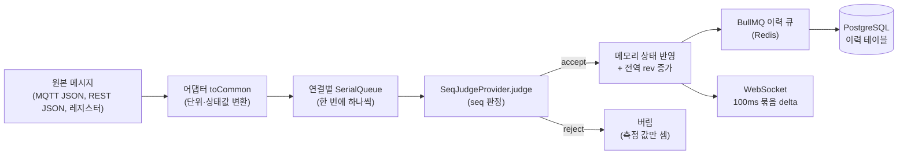
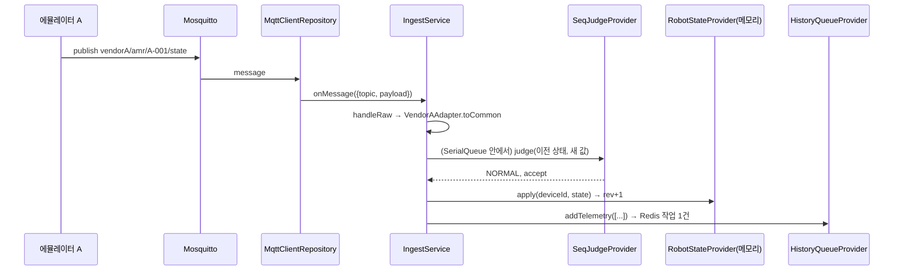
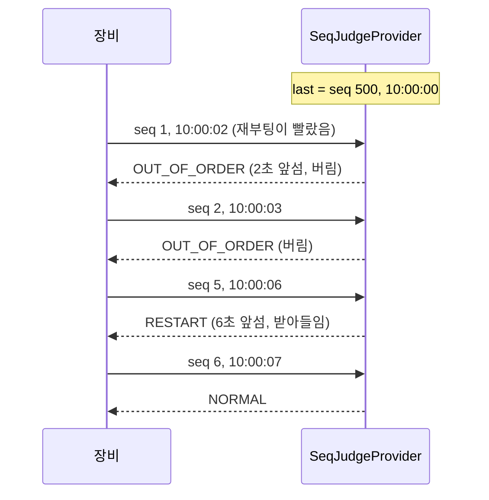
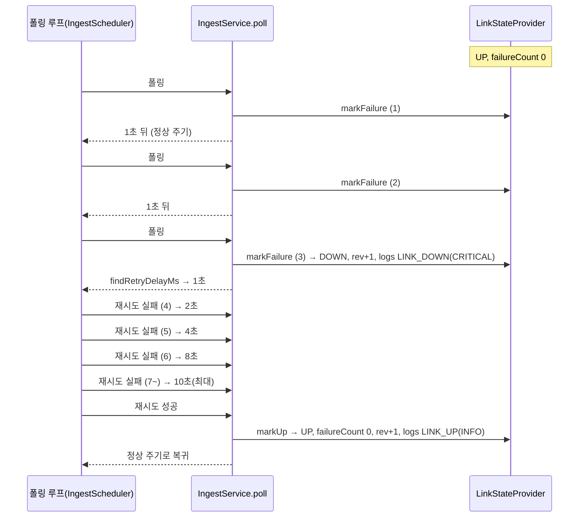
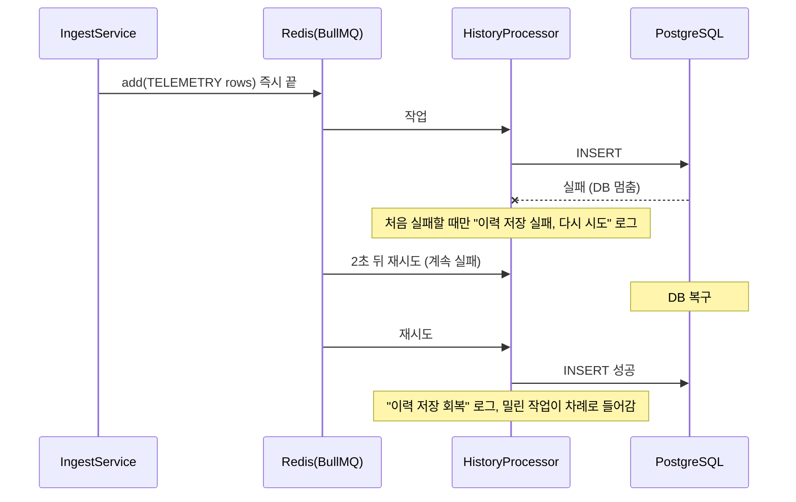
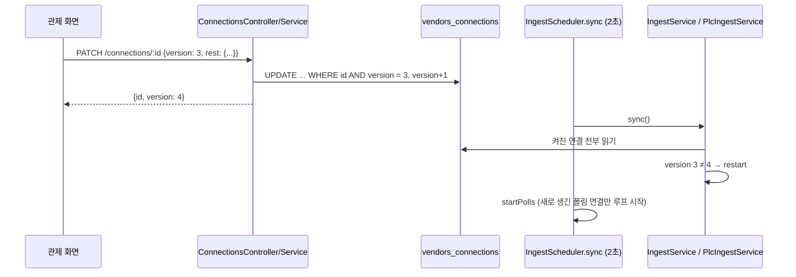
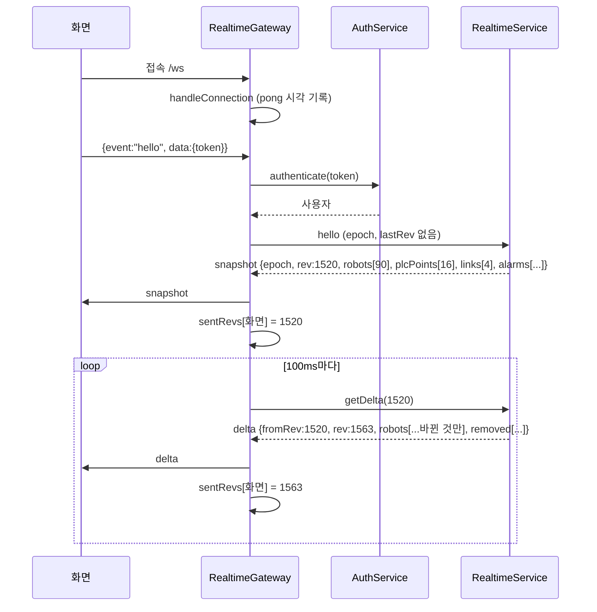

# 케이스별 동작 정리 (코드 기준)

미들웨어가 상황마다 실제로 어떻게 움직이는지를 코드에서 그대로 따라가며 정리한 문서입니다. 각 케이스는 **상황 → 코드 흐름 → 결과(메모리 상태, logs 테이블, 서버 로그, WebSocket)** 순서로 적었습니다.

- 경로는 모두 `apps/middleware/src/` 아래 기준입니다. 예: `ingest/ingest.service.ts` `IngestService.handleRaw`
- 줄 번호 대신 클래스와 메서드 이름으로 가리킵니다. 줄 번호는 코드가 바뀌면 틀어지기 때문입니다.
- 설계 이유와 대안은 [설계 근거](design-rationale.md), 측정 결과는 [측정](measurements.md)에 있습니다.

## 목차

0. [먼저 알아 둘 것: 공통 수집 파이프라인과 기준값](#0-먼저-알아-둘-것)
1. [정상 수신 (제조사 A·B·C, PLC)](#1-정상-수신)
2. [seq 판정: 중복, 순서 뒤바뀜, 유실, 장비 재시작](#2-seq-판정)
3. [STALE (데이터 끊김 표시)](#3-stale)
4. [연결 끊김 → 재시도 → 복구](#4-연결-끊김--재시도--복구)
5. [DB 장애, Redis 장애](#5-db-장애-redis-장애)
6. [연결 설정 변경 (API → 동기화)](#6-연결-설정-변경)
7. [미들웨어 재시작 (상태 복구)](#7-미들웨어-재시작)
8. [WebSocket (hello, snapshot, delta, 재접속, 느린 화면)](#8-websocket)
9. [알람 (열림, 해제, 확인)](#9-알람)
10. [로그인과 토큰](#10-로그인과-토큰)
11. [장애 주입별로 미들웨어가 보이는 반응](#11-장애-주입별-반응)
12. [측정 값이 쌓이는 곳](#12-측정)
13. [코드를 읽다가 발견한 점](#13-코드를-읽다가-발견한-점)

---

## 0. 먼저 알아 둘 것

### 공통 수집 파이프라인

제조사가 달라도 어댑터 뒤로는 같은 길을 탑니다.



핵심은 두 가지입니다.

1. **메모리가 진짜 현재 상태**입니다. 현재 상태 테이블은 없습니다(`state/robot-state.repository.ts`). 조회 API(`GET /robots`)와 WebSocket은 메모리만 읽어서 DB가 느리거나 죽어도 영향을 받지 않습니다.
2. **바뀔 때마다 전역 rev가 1씩 오릅니다**(`state/revision.repository.ts` `RevisionRepository.next`). WebSocket은 "화면이 마지막으로 받은 rev 이후로 rev가 오른 것"만 보냅니다.

### 기준값 (config 파일)

| 값                   | 기본                                    | 위치                                              | 쓰이는 곳 |
| -------------------- | --------------------------------------- | ------------------------------------------------- | --------- |
| 설정 동기화 주기     | 2초                                     | `config/ingest.config.ts` `syncIntervalMs`        | 6장       |
| 장비 재시작 판정     | sourceTs가 5초 이상 앞섬                | `config/ingest.config.ts` `restartThresholdMs`    | 2장       |
| Modbus 읽기 타임아웃 | 800ms                                   | `config/ingest.config.ts` `modbusReadTimeoutMs`   | 4장       |
| 폴링 연결 DOWN 기준  | 연속 실패 3번                           | `config/link.config.ts` `downAfterFailures`       | 4장       |
| 재시도 간격          | 1초부터 두 배씩, 최대 10초              | `config/link.config.ts` `minRetryMs`·`maxRetryMs` | 4장       |
| 로봇 STALE           | 3초 조용함, 또는 지연 3초 초과          | `config/stale.config.ts`                          | 3장       |
| PLC STALE            | 1.5초 조용함                            | `config/stale.config.ts` `plcSilenceMs`           | 3장       |
| 이력 큐 재시도       | 2초 간격 900번(30분)                    | `config/queue.config.ts`                          | 5장       |
| WebSocket delta      | 100ms                                   | `config/realtime.config.ts` `deltaIntervalMs`     | 8장       |
| ping, 끊김 판정      | 5초마다 ping, pong 2번 연속 없으면 끊음 | `config/realtime.config.ts`                       | 8장       |
| 느린 화면 기준       | 보내지 못한 데이터 1MB 초과             | `config/realtime.config.ts` `maxBufferedBytes`    | 8장       |
| 알람 판정 주기       | 500ms                                   | `config/alarm.config.ts`                          | 9장       |
| 배터리 부족          | 20% 미만                                | `config/alarm.config.ts` `lowBatteryPct`          | 9장       |
| 토큰 유효 시간       | 12시간                                  | `config/auth.config.ts`                           | 10장      |

STALE 기준 3초와 1.5초는 각각 로봇 주기(1초)와 PLC 주기(500ms)의 3배입니다. 주기를 연결 설정에서 바꿔도 STALE 기준은 따라 바뀌지 않는 고정값입니다.

### 시작 순서

`ingest/ingest.scheduler.ts` `IngestScheduler.onApplicationBootstrap`

1. `IngestService.start()`: 켜진 연결 중 로봇이 있는 연결을 읽어 장비를 메모리에 등록 → 이력으로 상태 복구(7장) → MQTT 연결은 구독 시작
2. `PlcIngestService.start()`: PLC가 있는 연결을 등록 → 점 값 복구
3. `startPolls()`: REST, Modbus 연결마다 폴링 루프를 건다
4. 2초마다 `sync()`를 거는 interval 등록(6장)

---

## 1. 정상 수신

### 1-1. 제조사 A (MQTT 푸시, 40대, 1초)

**상황**: 에뮬레이터가 `vendorA/amr/{serial}/state` 토픽으로 로봇마다 JSON을 QoS 1로 발행합니다.



1. 접속: `IngestService.startPushConnection` → `MqttLinkProvider.start` → `MqttClientRepository.subscribe`. 클라이언트 id는 `middleware-{connectionId}`, `clean: true`(세션 안 남김), 자동 재접속은 끄고 직접 합니다(4장).
2. 접속되면 `connect` 이벤트에서 `onLinkChange(true)` → `LinkStateProvider.markUp`으로 연결이 UP, 그다음 `handleConnect`가 토픽을 구독합니다. 세션을 안 남기므로 접속할 때마다 다시 구독합니다.
3. 메시지가 오면 `IngestService.handleRaw`
   - `VendorAAdapter.toCommon`(`ingest/adapters/vendor-a.adapter.ts`): 토픽 세 번째 조각이 serial(`A-001`), 라디안 → 도, 배터리 0~1 → 0~100, `mode`(driving 등) → 공통 `opState`(MOVING 등). 변환이 실패하면 `toReadings`가 경고 로그만 남기고 빈 배열을 돌려 그 메시지는 버립니다.
   - 연결별 `SerialQueue`(`ingest/serial-queue.ts`) 안에서 `applyReadings`가 실행됩니다. 메시지가 동시에 여러 개 와도 판정과 반영 사이에 다른 메시지가 끼어들지 않습니다.
   - `applyReading`: externalId로 메모리에서 장비를 찾고(없으면 버림) → `SeqJudgeProvider.judge` → `IngestMetricsProvider.record`로 측정 값 기록 → accept면 `RobotStateProvider.apply`가 상태를 바꾸고 rev를 올립니다.
   - 큐 밖에서 `HistoryQueueProvider.addTelemetry`로 받아들인 행을 BullMQ에 넣습니다.
4. `HistoryProcessor.process` → `HistoryService.save` → `TelemetryProvider.saveAll` → `vendors_connections_devices_telemetry`에 INSERT.

**결과**: 메모리 상태와 rev가 바뀌고, 다음 100ms 묶음 delta에 그 로봇이 실립니다. DB 이력은 큐를 거쳐 조금 뒤에 들어갑니다. 제조사 A는 메시지 하나가 로봇 한 대라서 이력 작업도 로봇 한 대당 하나입니다.

### 1-2. 제조사 B (REST 폴링, 30대, 1초)

**상황**: 미들웨어가 1초마다 `GET {baseUrl}/api/vehicles`를 부릅니다(시드 설정 `mode: "bulk"`).

1. 루프: `IngestScheduler.startPoll` → `schedulePoll`(setTimeout을 `SchedulerRegistry.addTimeout`으로 등록) → `runPoll` → `IngestService.poll`. 연결 하나에 루프 하나만 돌도록 `activePolls` Set으로 막습니다.
2. `IngestService.poll`
   - `pollOnce` → `tryFetchRaws` → `RestLinkProvider.poll` → `RestClientRepository.get`(fetch, `timeoutMs` 800ms로 끊음, 2xx가 아니면 에러).
   - 성공하면 `LinkStateProvider.markUp` 후 응답마다 `handleRaw`. 이후는 1-1과 같습니다.
   - 실패하면 `LinkStateProvider.markFailure`(4장)를 부르고 이번 차례는 끝냅니다.
3. 다음 차례까지 기다릴 시간을 돌려줍니다. 정상이면 `pollIntervalMs - 이번에 걸린 시간`(최소 0), 연결이 DOWN이면 재시도 간격(4장).
4. `VendorBAdapter.toCommon`: 응답에 `vehicles` 배열이 있으면 목록, 없으면 한 대 응답으로 봅니다. mm → m, mm/s → m/s, 방향은 0~360도로 맞추고, `errorCode`가 빈 문자열이면 null.

`mode: "each"`로 바꾸면 차량마다 `GET /api/vehicles/{id}`를 `Promise.all`로 동시에 부릅니다. 이 경우 한 대만 실패해도 이번 폴링 전체가 실패로 셉니다.

**결과**: 한 번 폴링한 응답이 30대 묶음이라 이력 작업도 묶음 하나(30행)입니다.

### 1-3. 제조사 C (Modbus TCP 폴링, 20대, 1초)

**상황**: 홀딩 레지스터(FC3)에 차량마다 16개 레지스터 블록이 있습니다. 차량 n의 시작 주소는 `100 + 16n`.

1. 루프는 1-2와 같고, `IngestService.fetchRaws`가 externalId(`"0"`~`"19"`, 블록 번호)를 숫자로 바꿔 `ModbusLinkProvider.poll`을 부릅니다.
2. `ModbusLinkProvider.poll`: Modbus 한 요청은 레지스터 125개가 한계라 한 번에 7블록(125/16)씩 끊어 읽습니다. 20대면 7 + 7 + 6, 세 번을 **차례로** 읽습니다(한 접속에 요청을 하나씩). 블록이 요청 사이에서 쪼개지지 않아 한 차량의 값과 seq가 어긋나지 않습니다.
3. `ModbusClientRepository.readHoldingRegisters`: 연결마다 클라이언트 하나를 재사용합니다. 읽기가 실패하면 접속을 닫고 에러를 던지며, 다음 읽기 때 새로 붙습니다.
4. `VendorCAdapter.toCommon`: +0~1 seq(32비트), +2~4 시각(48비트 ms), +5~6 x·y(cm, 부호 있음), +7 방향(0.1도), +8 속도(cm/s), +9 배터리, +10 상태 코드(0~4, 모르는 값은 ERROR), +11 오류 코드(0이면 null), +12 비트0 적재.

**결과**: 한 번 폴링에 읽기 응답이 3개라 이력 작업도 3개입니다.

### 1-4. PLC (Modbus TCP 폴링, 16점, 500ms)

**상황**: 입력 레지스터(FC4) 0~5. 0번 레지스터의 비트 16개가 점 16개, 1~2는 seq, 3~5는 시각입니다.

1. 루프는 같고 `PlcIngestService.poll` → `pollOnce` → `ModbusLinkProvider.pollInputBlock` → `ModbusClientRepository.readInputRegisters`.
2. 성공하면 `markUp` 후 `PlcAdapter.toCommon`이 비트를 `boolean[16]`으로 풉니다.
3. `PlcIngestService.applyReading`
   - 장비 단위로 seq 판정: 마지막으로 읽은 seq·시각(`findLastRead`)과 비교합니다.
   - accept면 `updateLastRead`로 마지막 읽기를 갱신하고(STALE 판단에 쓰임),
   - `applyChangedPoints`: 16점 중 **값이 바뀐 점만** 메모리에 반영하고 rev를 올립니다.
   - 바뀐 점만 `HistoryQueueProvider.addPlcEvents`로 `vendors_connections_devices_plc_points_events`에 이벤트로 남깁니다.

**결과**: 값이 그대로면 rev도 이력도 늘지 않습니다. 500ms보다 짧게 켰다 꺼진 펄스는 폴링 사이에 지나가서 놓칩니다(클래스 주석에 적어 둔 한계).

---

## 2. seq 판정

모든 수신(로봇, PLC)은 `ingest/providers/seq-judge.provider.ts` `SeqJudgeProvider.judge(last, next)`를 거칩니다. 위에서부터 차례로 검사합니다.

| 순서 | 조건                                                | 판정         | 받아들임 | 측정 값               |
| ---- | --------------------------------------------------- | ------------ | -------- | --------------------- |
| 1    | 이전 값이 없음                                      | FIRST        | O        |                       |
| 2    | `next.seq == last.seq + 1`                          | NORMAL       | O        |                       |
| 3    | `next.seq > last.seq + 1`                           | GAP          | O        | missed += 건너뛴 개수 |
| 4    | `next.seq == last.seq`                              | DUPLICATE    | X        | duplicates += 1       |
| 5    | seq가 줄었고 `next.sourceTs - last.sourceTs >= 5초` | RESTART      | O        |                       |
| 6    | seq가 줄었고 위가 아님                              | OUT_OF_ORDER | X        | outOfOrder += 1       |

`last`는 메모리에 있는 마지막으로 **받아들인** 값입니다. 버린 메시지는 `last`를 바꾸지 않습니다.

### 2-1. 중복 (DUPLICATE)

**상황**: 같은 seq가 다시 옵니다. MQTT QoS 1은 "최소 한 번" 전달이라 실제로도 생길 수 있고, 장애 주입 `duplicatePct`로도 만듭니다.

**흐름**: `IngestService.applyReading` → `judge`가 DUPLICATE, accept false → `IngestMetricsProvider.record`에서 duplicates만 올리고 return null.

**결과**: 메모리, rev, 이력, WebSocket 모두 변화 없음. 로그도 남기지 않습니다. `GET /metrics`의 `duplicates`만 늘어납니다.

### 2-2. 순서 뒤바뀜 (OUT_OF_ORDER)

**상황**: seq 10을 받아들인 뒤에 늦게 출발한 seq 9가 옵니다.

**흐름**: seq가 줄었는데 sourceTs가 더 과거(또는 5초 미만 앞섬)라 OUT_OF_ORDER로 버립니다.

**결과**: 화면 위치가 과거로 되돌아가지 않습니다. 측정 값 `outOfOrder`만 오릅니다. seq 9는 이력에도 남지 않습니다.

예시 (A 로봇 한 대):

```text
받은 순서   seq  판정           메모리 seq
1           7    NORMAL         7
2           9    GAP(missed 1)  9
3           8    OUT_OF_ORDER   9   ← 8은 버림. 위에서 missed로 센 1건은 그대로
4           9    DUPLICATE      9
5           10   NORMAL         10
```

seq 8은 결국 도착했지만 GAP에서 이미 유실로 셌기 때문에 유실률 계산에는 유실로 남습니다. 늦게 온 값을 다시 끼워 넣지 않는 대신, 화면은 항상 앞으로만 갑니다.

### 2-3. 유실 (GAP)

**상황**: seq 9 다음에 12가 옵니다.

**흐름**: GAP, missed = 2, **받아들입니다**. 빈 구간을 기다리지 않고 최신 값을 바로 씁니다.

**결과**: 메모리는 seq 12로 갑니다. `GET /metrics`의 `missed`가 2 오르고, 유실률은 `missed / (accepted + missed)`(`metrics/metrics.service.ts` `toIngestItem`)로 계산합니다. 빠진 10, 11을 다시 요청하는 기능은 없습니다(장비 쪽에 재요청 API가 없다는 전제).

### 2-4. 장비 재시작 (RESTART, 5초 규칙)

**상황**: 장비가 재부팅해서 seq가 0부터 다시 시작합니다. seq만 보면 "과거 메시지"와 구별할 수 없습니다.

**흐름**: seq가 줄었을 때 sourceTs를 봅니다. 마지막으로 받아들인 값보다 **5초 이상 미래**면 재시작으로 보고 받아들입니다. 그보다 가까우면 OUT_OF_ORDER로 버립니다.



**결과**: 재부팅이 5초보다 빨랐다면 길어야 약 5초 동안 새 값을 버리다가 따라잡습니다. 그 사이 수신이 없는 것으로 보여 3초 기준 STALE이 잠깐 켜질 수 있습니다. 반대로 진짜로 늦게 온 메시지는 sourceTs가 과거라서 재시작으로 오해하지 않습니다. 장비 시계가 크게 틀어져 있으면 이 판정도 틀어진다는 점이 이 규칙의 전제입니다.

---

## 3. STALE

**상황**: 연결은 살아 있지만 특정 장비 데이터가 안 오거나, 오더라도 너무 늦게 옵니다.

STALE은 저장해 두는 값이 아니라 **읽을 때마다 계산**합니다. `device/stale-judge.provider.ts`

- `isRobotStale(state, linkStatus, now)`: 다음 중 하나면 true
  - 연결이 DOWN
  - 아직 한 번도 받은 적이 없음(state가 null)
  - 마지막 수신 후 3초 넘게 조용함(`now - receivedTs > 3000`)
  - 받은 시각과 장비 시각의 차이가 3초 초과(`receivedTs - sourceTs > 3000`), 즉 계속 오지만 늦게 옴
- `isPlcStale(lastRead, linkStatus, now)`: 연결 DOWN, 아직 못 읽음, 마지막 읽기 후 1.5초 초과

**누가 부르나**

| 어디서                           | 메서드                                                 | 쓰임              |
| -------------------------------- | ------------------------------------------------------ | ----------------- |
| `GET /robots`, `GET /robots/:id` | `device/robots.service.ts` `toItem`                    | 응답의 `stale`    |
| WebSocket snapshot·delta         | `realtime/realtime.service.ts` `toRobot`, `toPlcPoint` | 메시지의 `stale`  |
| 알람 판정(500ms)                 | `alarm/alarm.service.ts` `collectCandidates`           | DEVICE_STALE 알람 |

**화면이 STALE로 바뀌는 순간을 아는 방법**: 데이터가 안 오면 로봇의 rev가 안 올라서 delta에 실리지 않습니다. 그래서 알람 판정이 DEVICE_STALE을 열거나 풀 때 `AlarmTargetProvider.touchDevice`가 그 장비(PLC면 그 장비의 점 전부)의 rev를 올립니다. 다음 delta에 그 장비가 `stale: true`로 다시 실립니다(`AlarmService.apply`).

**결과 정리**

| 상황                                 | stale                  | DEVICE_STALE 알람                                            |
| ------------------------------------ | ---------------------- | ------------------------------------------------------------ |
| 로봇 한 대만 3초 넘게 안 옴, 연결 UP | true                   | 열림 (WARN, logs에 ALARM_RAISED)                             |
| 지연 4초로 계속 옴                   | true                   | 열림                                                         |
| 연결 DOWN                            | 그 연결 장비 전부 true | 전부 열림                                                    |
| 시작 직후, 연결 판정 전(UNKNOWN)     | true                   | **안 열림** (재시작 직후 오래된 상태로 알람이 쏟아지지 않게) |
| 다시 정상 수신                       | false                  | 풀림 (ALARM_CLEARED)                                         |

---

## 4. 연결 끊김 → 재시도 → 복구

연결 상태는 `UNKNOWN`(시작 직후, 아직 판정 전) → `UP` / `DOWN` 세 가지이고, 메모리 `state/link-state.repository.ts`에 있습니다. 판정은 `ingest/providers/link-state.provider.ts` `LinkStateProvider`가 합니다. **상태가 바뀔 때만** rev를 올리고 logs 테이블에 남깁니다(실패 횟수만 바뀌면 rev 그대로).

### 4-1. 폴링 연결 (B REST, C Modbus, PLC)

**상황**: 장비가 응답을 안 하거나(타임아웃) 에러를 돌려줍니다.



1. 실패: `IngestService.tryFetchRaws`(PLC는 `PlcIngestService.tryPollInputBlock`)가 예외를 잡아 `markFailure`. 연속 실패 수를 올리고, 3번째에 DOWN으로 바꾸면서 `LINK_DOWN` 로그(CRITICAL, 이유 문자열 포함)를 남깁니다. 한두 번 실패는 상태를 바꾸지 않아 순간 오류로 깜빡이지 않습니다.
2. 재시도 간격: `poll()` 끝에서 `findRetryDelayMs`가 DOWN이면 `min(1초 × 2^(실패수-3), 10초)`를 돌려줍니다. 1, 2, 4, 8, 10, 10초 순입니다. 스케줄러는 이 값으로 다음 setTimeout을 겁니다.
3. Modbus는 읽기 실패 때 `ModbusClientRepository`가 소켓을 닫으므로 다음 재시도는 새 접속부터 합니다.
4. 복구: 성공하면 `markUp`이 UP으로 바꾸고 failureCount를 0으로, `LINK_UP` 로그를 남깁니다. 다음 간격은 다시 `pollIntervalMs` 기준입니다.

**결과**: DOWN 동안 그 연결의 장비는 모두 STALE, DEVICE_STALE 알람 열림. WebSocket delta의 `links`에 상태 변화가 실립니다. 복구되면 첫 값은 보통 GAP(missed = 끊긴 동안 건너뛴 seq 수)으로 받아들입니다.

### 4-2. MQTT 연결 (A)

**상황**: 브로커가 죽거나 네트워크가 끊깁니다. MQTT는 끊김 이벤트가 있어서 실패 횟수를 세지 않고 바로 DOWN입니다.

1. `MqttClientRepository`의 `close` 이벤트 → `onLinkChange(false)` → `LinkStateProvider.markDown`(이미 DOWN이면 아무것도 안 함) → `LINK_DOWN` 로그 "브로커 연결 종료".
2. `reconnectLater`: 1초 기다렸다가 `client.reconnect()`. 실패해서 다시 close가 오면 2초, 4초, 8초, 10초(최대)로 늘립니다. mqtt.js 자동 재접속은 간격이 고정이라 끄고(`reconnectPeriod: 0`) 직접 합니다.
3. 접속되면 `connect` 이벤트에서 재시도 간격을 1초로 되돌리고 `markUp`, 그다음 다시 구독합니다.
4. `clean: true`라서 끊긴 동안의 메시지는 브로커가 보관하지 않습니다. 재접속 직후 밀린 메시지가 몰려오지 않는 대신, 그동안의 데이터는 GAP으로 셉니다.
5. `isActive` 검사로, 앱 종료나 설정 변경으로 내린 클라이언트의 close 이벤트는 끊김으로 보지 않습니다.

**에뮬레이터 쪽 "끊김" 주입은 다르게 보입니다**: A의 `disconnected`는 에뮬레이터가 발행만 멈추는 것이고 미들웨어와 브로커 사이는 살아 있습니다. 그래서 연결은 UP으로 남고, 40대가 3초 뒤 STALE이 되어 DEVICE_STALE 알람 40개가 열립니다(11장).

---

## 5. DB 장애, Redis 장애

### 5-1. DB(PostgreSQL) 장애

**상황**: DB가 멈추거나 느려집니다.

| 기능                                     | 영향                                                               | 코드                                                                |
| ---------------------------------------- | ------------------------------------------------------------------ | ------------------------------------------------------------------- |
| 수집, 메모리 반영, WebSocket             | **영향 없음**. 이력 INSERT를 기다리지 않음                         | `IngestService.handleRaw`는 큐에 넣기만 함                          |
| `GET /robots`, `GET /plc-points` 현재 값 | 영향 없음(메모리)                                                  | `device/robots.provider.ts`                                         |
| 이력 저장                                | 큐 작업이 실패 → 2초 간격 최대 900번(30분) 재시도                  | `HistoryQueueProvider.add`, `HistoryProcessor`                      |
| 연결 설정 동기화                         | 매 2초 실패, 서버 로그 "설정 동기화 실패". 기존 연결은 그대로 동작 | `IngestScheduler.sync`의 catch                                      |
| logs 테이블 기록(LINK_UP/DOWN, 알람)     | 기록 실패, 서버 로그 경고만. 판정·수집은 계속                      | `LinkStateProvider.writeLog`, `AlarmStateProvider.writeLog`의 catch |
| 이력·로그·연결 조회 API, 로그인          | 500 에러(`ApiResult.ofError`)                                      | `common/filters/all-exceptions.filter.ts`                           |



**결과**: DB가 30분 안에 돌아오면 이력은 빠짐없이 들어갑니다(작업마다 재시도 횟수를 따로 셈). 30분을 넘긴 작업은 실패 작업으로 최근 1000개만 Redis에 남고 자동으로 다시 넣지는 않습니다. 재시도 동안 작업이 Redis에 쌓입니다. 제조사 A는 메시지 하나가 작업 하나라서 초당 40개 남짓, 30분이면 7만 개 수준입니다.

### 5-2. Redis 장애

**상황**: Redis가 멈춥니다.

1. 이력 큐 연결은 `enableOfflineQueue: false`(`ingest/ingest.module.ts`)라서 넣기가 기다리지 않고 바로 실패합니다.
2. `HistoryQueueProvider.add`가 예외를 잡아 **버립니다**. 처음 실패할 때 "이력 큐 넣기 실패", 다시 되면 "이력 큐 넣기 회복" 로그를 한 번씩만 남깁니다.
3. 수집, 메모리, WebSocket, 알람은 그대로 동작합니다.

**결과**: Redis가 멈춘 동안의 이력은 **남지 않습니다**. 현재 상태가 메모리에 있으므로 관제 화면은 정상이고, 이력 조회에만 그 시간대가 비어 보입니다. DB 장애는 Redis가 버퍼가 되어 주지만, Redis 장애에는 버퍼가 없다는 것이 이 구조에서 감수한 점입니다.

---

## 6. 연결 설정 변경

연결 설정은 DB `vendors_connections`에 있고, 수집 쪽은 2초마다 DB를 다시 읽어 맞춥니다. API와 수집 사이에 직접 호출은 없습니다.



### 6-1. 설정 고치기 (PATCH /connections/:id)

`connection/connections.service.ts` `ConnectionsService.patchConnection`

1. 요청 검증(class-validator): `version` 필수, config는 `mqtt`·`rest`·`modbus` 중 연결 protocol에 맞는 것 **하나만**. 둘 이상이거나 protocol과 다르면 400.
2. MQTT `password`를 빼고 보내면 저장된 값을 유지합니다(`toConfig`). 조회(`GET /connections/:id`) 때는 password를 빼고 `hasPassword`만 줍니다.
3. `VendorsConnectionsRepository.updateIfVersion`: `WHERE id AND version = 보낸 version`으로 고치고 version을 1 올립니다. 고친 행이 0이면 **409** "다른 곳에서 먼저 고쳤습니다"(낙관적 잠금). 이름이 겹치면 409.
4. 없는 id면 404.

수집 쪽 반영은 최대 2초 뒤 `IngestService.sync` / `PlcIngestService.sync`에서:

| 바뀐 것                    | 동작                                                                                                                                                                   |
| -------------------------- | ---------------------------------------------------------------------------------------------------------------------------------------------------------------------- |
| version이 바뀜 (로봇 연결) | `IngestService.restart`: 기존 접속을 끊고(MQTT 구독 해제, Modbus 소켓 닫기) 새 설정 저장, 연결 상태를 UNKNOWN으로, MQTT면 새 설정으로 다시 구독. 장비 상태는 그대로 둠 |
| version이 바뀜 (PLC 연결)  | Modbus 소켓 닫고 새 설정 저장, 연결 상태 UNKNOWN                                                                                                                       |
| 폴링 주기 변경             | 폴링 루프는 매번 `connections` 맵에서 설정을 새로 읽으므로 다음 차례부터 새 주기                                                                                       |
| `enabled: false`           | 아래 6-3                                                                                                                                                               |

이름만 바꿔도 version이 오르므로 접속을 한 번 끊었다 다시 붙습니다.

### 6-2. 연결 추가 (POST /connections)

1. 없는 제조사면 400, config가 없으면 400, 이름 중복 409.
2. 다음 sync에서 `loadConnections`가 읽지만 **장비가 하나도 없는 연결은 수집 대상에서 빠집니다**(로봇이 있어야 `IngestService`, PLC가 있어야 `PlcIngestService`). 장비 등록 API는 없어서 지금은 시드로 들어간 연결만 실제로 수집합니다.

### 6-3. 끄기와 지우기

- `PATCH {enabled: false}`: 다음 sync에서 그 연결이 목록에서 빠지므로 `IngestService.close`
  - 접속 끊기, 장비 메모리에서 제거, 연결 상태 제거
  - 지운 장비와 연결을 `RemovedEntityRepository`에 rev와 함께 기록 → 다음 delta의 `removed`에 실려 화면에서 사라짐
  - 폴링 루프는 다음 차례에 `poll()`이 null을 받아 멈춤
  - 알람 판정 대상에서 빠지므로 그 장비의 열린 알람은 다음 판정 때 풀림(`AlarmService.evaluate` 마지막 반복)
- 다시 `enabled: true`: 새 연결처럼 등록. 장비 상태는 null부터 다시 시작(첫 값은 FIRST).
- `DELETE /connections/:id`: 장비가 딸린 연결은 이력이 걸려 있어 **409**로 막고 "enabled를 false로 바꿔 끄세요"라고 안내. 장비 없는 연결만 지웁니다.

---

## 7. 미들웨어 재시작

**상황**: 미들웨어 프로세스가 다시 뜹니다. 메모리 상태는 사라졌습니다.

1. `IngestService.start` → `restoreLatestStates`: `TelemetryProvider.findLatestStates` → `SELECT DISTINCT ON (장비) ... ORDER BY source_ts DESC`로 장비마다 마지막 이력 한 행을 읽어 메모리에 넣습니다. 서버 로그 "로봇 상태 N대 복구".
2. `PlcIngestService.start` → `restoreLatestValues`: 점마다 마지막 이벤트 값을 넣습니다. 서버 로그 "PLC 점 N개 복구". PLC 장비의 마지막 읽기(seq)는 복구하지 않으므로 첫 폴링은 FIRST로 받아들입니다.
3. 연결 상태는 모두 UNKNOWN에서 시작합니다.
4. `RevisionRepository`는 새 `epoch`(UUID)와 rev 0으로 시작합니다.

**결과**

- 화면은 재시작 직후에도 마지막 위치를 보여 줍니다. 다만 `receivedTs`가 과거라 STALE로 표시됩니다.
- 연결이 UNKNOWN인 동안은 DEVICE_STALE 알람을 열지 않습니다(`AlarmJudgeProvider.toStaleCandidate`). 첫 수신이나 첫 실패 판정 뒤부터 정상 판정.
- 첫 수신의 seq 판정은 복구한 seq와 비교합니다.
  - 에뮬레이터가 계속 돌고 있었다면 GAP(missed = 꺼져 있던 동안의 seq 수). 유실률 측정에 이 값이 들어갑니다.
  - 장비도 같이 재시작했다면 seq가 작고 sourceTs가 5초 이상 앞서 RESTART.
- 알람은 메모리에만 있어서 사라졌다가 첫 판정에서 다시 열립니다. 이전의 확인(ack) 기록은 logs 테이블에만 남고, 다시 열린 알람은 미확인 상태입니다.
- 이력 큐에 남아 있던 작업은 Redis에 있으므로 재시작 뒤 이어서 저장됩니다.
- 시작할 때 DB를 읽지 못하면 `start()`가 실패해 앱이 뜨지 않습니다. docker compose는 postgres가 healthy가 된 뒤에 미들웨어를 띄웁니다.
- 화면은 epoch가 바뀐 것을 보고 snapshot을 새로 받습니다(8-3).

---

## 8. WebSocket

경로는 `/ws`, 메시지는 `{ event, data }` JSON입니다. `realtime/realtime.gateway.ts` `RealtimeGateway`, `realtime/realtime.service.ts` `RealtimeService`.

### 8-1. 처음 접속 (hello → snapshot)



1. 접속만으로는 아무것도 받지 않습니다. `hello`를 보내야 `sentRevs`에 등록되고 그때부터 delta를 받습니다.
2. `hello` 처리: 토큰 확인 → `RealtimeService.hello` → epoch가 없거나 다르거나 lastRev가 없으면 **snapshot**(전체 상태).
3. `getSnapshot`: rev를 **먼저** 읽고 나서 전체를 모읍니다. 모으는 사이에 바뀐 엔티티는 다음 delta에 한 번 더 실릴 수 있지만 빠지지는 않습니다.
4. `reply`: 답을 보낸 **뒤에** `sentRevs`를 기록합니다. 그래야 다음 delta가 snapshot보다 먼저 가지 않습니다.

### 8-2. delta (100ms 묶음)

`RealtimeGateway.pushDeltas`가 100ms마다:

1. 화면마다 마지막으로 보낸 rev(`sentRev`)를 봅니다. 같은 sentRev인 화면들은 delta를 **한 번만 만들어 같이** 씁니다(대부분 화면이 같은 rev에 있으므로 화면 수가 늘어도 계산은 거의 그대로).
2. `getDelta(fromRev)`: 서버 rev가 같으면 null(보낼 것 없음). 아니면 `collectChanged(fromRev)`로 rev가 fromRev보다 큰 로봇, PLC 점, 연결, 알람과, fromRev 이후 지워진 엔티티(`removed`)를 모읍니다.
3. 보내고 `sentRevs`를 delta.rev로 올립니다.
4. 이전 묶음이 아직 안 끝났으면 이번 차례는 건너뜁니다(`pushing` 플래그).

긴급 메시지를 따로 즉시 보내는 경로는 없습니다. 알람도 같은 100ms 묶음에 실립니다.

### 8-3. 재접속 (epoch, lastRev로 이어받기)

**상황**: 화면 네트워크가 잠깐 끊겼다가 다시 붙습니다.

1. 화면이 `hello {token, epoch, lastRev}`를 보냅니다.
2. `RealtimeService.hello`
   - epoch가 서버와 같고 lastRev가 있으면 `resync(lastRev)`
     - lastRev가 서버 rev보다 크면(있을 수 없는 값) snapshot
     - 아니면 **delta**(lastRev 이후 바뀐 것만)
   - epoch가 다르면(미들웨어가 재시작함, rev가 이어지지 않음) **snapshot**
3. `resync` 메시지(`{event:"resync", data:{lastRev}}`)도 같은 로직입니다. hello 전에 보내면 에러 메시지.

delta 방식이라 끊긴 동안 여러 번 바뀐 엔티티도 마지막 값 하나만 받습니다. 이력은 REST로 따로 조회합니다.

### 8-4. 느린 화면 건너뛰기

**상황**: 한 화면의 네트워크가 느려서 보낸 데이터가 소켓 버퍼에 쌓입니다.

**흐름**: `pushDeltas`에서 `client.bufferedAmount > 1MB`이거나 소켓이 OPEN이 아니면 **이번 delta를 보내지 않고 sentRev도 그대로** 둡니다.

**결과**: 다른 화면에는 영향이 없습니다. 느린 화면은 버퍼가 빠지면 다음 차례에 밀린 구간 전체를 담은 delta 하나를 받습니다(sentRev가 안 올랐으므로). 중간 값만 건너뛰고 빠지는 엔티티는 없습니다.

### 8-5. 끊김 감지 (ping/pong)

- 서버가 5초마다 `{event:"ping"}`을 보내고, 화면은 `pong`으로 답합니다(`pingClients`, `pong`).
- 마지막 pong이 10초(5초 × 2번) 넘게 없으면 `terminate()`. 그러면 `handleDisconnect`가 `sentRevs`와 pong 기록을 지웁니다.
- 화면이 `ping`을 보내면 서버가 `pong`으로 답합니다(화면 쪽 지연 측정용).

### 8-6. 인증 실패

- hello에 토큰이 없거나 틀리면 `AuthService.authenticate`가 401 예외 → `common/filters/ws-exceptions.filter.ts`가 `{event:"error", data:{message:"토큰이 필요합니다."}}`를 보냅니다.
- 소켓을 끊지는 않지만 `sentRevs`에 없으므로 delta는 받지 못합니다. 올바른 토큰으로 hello를 다시 보내면 됩니다.
- 토큰은 hello 때만 확인합니다. 접속 중에 토큰이 만료돼도 그 소켓은 계속 받습니다.
- hello 형식이 틀려도(예: lastRev가 음수) ValidationPipe 에러가 같은 error 메시지로 갑니다.

---

## 9. 알람

알람은 **메모리**(`state/alarm-state.repository.ts`)에 "지금 열려 있는 것"만 두고, 열림·해제·확인은 logs 테이블에 남깁니다. 같은 대상의 같은 코드는 하나만 열립니다(키: `코드:대상종류:대상id`).

### 알람 4종 (`alarm/providers/alarm-judge.provider.ts`)

| 코드         | 수준     | 대상           | 열리는 조건                                            |
| ------------ | -------- | -------------- | ------------------------------------------------------ |
| ROBOT_ERROR  | CRITICAL | 로봇           | `opState == ERROR`                                     |
| LOW_BATTERY  | WARN     | 로봇           | 배터리 20% 미만                                        |
| DEVICE_STALE | WARN     | 로봇, PLC 장비 | STALE이고 연결이 UNKNOWN이 아님                        |
| PLC_ABNORMAL | CRITICAL | PLC 점         | 알람을 켠 점(`alarm_on_abnormal`)의 값이 정상값과 다름 |

### 9-1. 열림과 해제

`alarm/alarm.scheduler.ts`가 500ms마다 `AlarmService.evaluate`:

1. `collectCandidates`: 로봇마다 3종, 알람 켠 PLC 점마다 1종, PLC 장비마다 STALE 1종을 판정해 `active` true/false 후보를 만듭니다.
2. `apply(후보)`: 지금 열려 있는지와 `active`가 같으면 아무것도 안 함.
   - active인데 안 열려 있음 → `AlarmStateProvider.raise`: 새 UUID, rev+1, logs `ALARM_RAISED`
   - 열려 있는데 active 아님 → `clear`: 메모리에서 지우고 `removed`에 ALARM 기록(rev+1), logs `ALARM_CLEARED`
   - DEVICE_STALE이 바뀌면 장비 rev도 올림(3장)
3. 이번에 판정하지 않은 대상(연결을 끄거나 지운 장비)의 열린 알람은 모두 풀립니다.

**결과**: WebSocket delta의 `alarms`에 열린 알람이, `removed`에 `{kind:"ALARM", id}`가 실립니다. 판정이 이전 차례를 못 끝냈으면 이번 차례는 건너뜁니다.

같은 조건이 풀렸다가 다시 생기면 **새 id**의 알람입니다. 이전 알람의 확인 여부는 이어지지 않습니다.

### 9-2. 확인 (POST /alarms/:id/ack)

`AlarmService.ackAlarm` → `AlarmStateProvider.ack`

| 상황                         | 결과                                                                                                     |
| ---------------------------- | -------------------------------------------------------------------------------------------------------- |
| 열린 알람, 처음 확인         | `ackedAt` 기록, rev+1, logs `ALARM_ACKED`(확인한 사용자 `roles_users_id` 포함). 200 `{id, ackedAt, rev}` |
| 이미 확인한 알람을 또 확인   | 상태와 로그를 바꾸지 않고 **처음 확인한 그대로** 200 (멱등)                                              |
| 이미 풀린 알람               | **404** "열린 알람이 없습니다"                                                                           |
| id 형식이 UUID가 아님        | 400                                                                                                      |
| 확인 직전에 판정이 풀어 버림 | `replace`가 같은 id가 아직 열려 있을 때만 바꾸므로 false → 404                                           |

확인해도 알람은 닫히지 않습니다. 조건이 풀려야 닫힙니다. 확인은 "사람이 봤다"는 표시입니다.

---

## 10. 로그인과 토큰

`auth/` 아래

- `POST /auth/login`(`@Public`): `AuthUserProvider.findByCredentials`가 `roles_users`에서 아이디를 찾고 argon2 `verify`로 비밀번호를 확인합니다. 아이디가 없든 비밀번호가 틀리든 같은 **401** "아이디 또는 비밀번호가 틀렸습니다"(무엇이 틀렸는지 알려 주지 않음). 맞으면 JWT(12시간, `sub`·`username`·`role`)와 `expiresIn`, `role`을 줍니다.
- 그 밖의 HTTP API: 전역 가드 `auth/guards/auth.guard.ts` `AuthGuard`가 `Authorization: Bearer <토큰>`을 요구합니다. 없거나, 형식이 틀렸거나, 서명이 틀렸거나, 만료됐거나, 토큰의 role이 모르는 값이면 **401**. `@Public`은 `GET /health`와 `POST /auth/login` 두 곳뿐입니다.
- 401 응답도 `{ success:false, data:null, error:{statusCode:401, message, path, timestamp} }` 구조입니다(`AllExceptionsFilter`).
- 통과하면 `request.user`에 사용자가 들어가고, 알람 확인 때 `@CurrentUser()`로 확인자를 기록합니다.
- 역할(VIEWER, OPERATOR, ADMIN)은 토큰에 담지만 **역할별 기능 차이는 두지 않았습니다**(설계 근거 16장).
- WebSocket은 HTTP 가드를 타지 않고 hello의 token으로 따로 확인합니다(8-6).
- DB가 죽어 있으면 로그인은 401이 아니라 500입니다.

---

## 11. 장애 주입별 반응

에뮬레이터 `:8090`의 `PUT /faults/{A|B|C|PLC}`로 그룹마다 걸고(`apps/emulator/src/faults/`), **미들웨어는 이 설정을 모릅니다**. 미들웨어 입장에서는 실제 장애와 같습니다.

에뮬레이터 쪽 구현이 푸시(A)와 폴링(B, C, PLC)이 다릅니다.

- A: `vendor-a/vendor-a-publisher.ts` `VendorAPublisher.publishAll`이 발행할 때 장애를 겁니다.
- B, C, PLC: `faults/polled-fault-picker.ts` `PolledFaultPicker`가 요청이 올 때 "어떤 시점의 스냅샷을 줄지" 고릅니다.

| 주입                 | 에뮬레이터 동작                         | 미들웨어 반응                                                                                     | 화면·측정                                                            |
| -------------------- | --------------------------------------- | ------------------------------------------------------------------------------------------------- | -------------------------------------------------------------------- |
| A `disconnected`     | 발행만 멈춤(브로커 연결은 유지)         | 연결은 UP 유지, 수신 없음                                                                         | 3초 뒤 40대 STALE, DEVICE_STALE 40개. 풀면 GAP으로 복귀              |
| B `disconnected`     | 소켓을 바로 닫음                        | fetch 실패 → 3번 뒤 DOWN, 1·2·4·8·10초 재시도                                                     | 30대 STALE, LINK_DOWN. 풀면 LINK_UP                                  |
| C·PLC `disconnected` | 응답 안 함                              | 800ms 타임아웃 → 3번 뒤 DOWN, 재시도                                                              | 같음                                                                 |
| A `lossPct`          | 그 비율만큼 발행 안 함                  | 다음 seq가 GAP                                                                                    | `missed`, 유실률                                                     |
| B `lossPct`          | 503 응답                                | **연결 실패로 셈**. 연속 3번이면 DOWN                                                             | 유실률이 아니라 연결 끊김으로 보임. 비율이 높으면 UP/DOWN이 오락가락 |
| C·PLC `lossPct`      | Modbus 예외 응답                        | 위와 같음, 소켓도 닫음                                                                            | 위와 같음                                                            |
| A `duplicatePct`     | 같은 메시지를 두 번 발행                | 두 번째는 DUPLICATE로 버림                                                                        | `duplicates`                                                         |
| 폴링 `duplicatePct`  | 직전에 준 스냅샷을 다시 줌              | 30대(또는 20대, PLC) 전부 DUPLICATE                                                               | `duplicates`                                                         |
| A `reorderPct`       | 1.5초 더 늦게 발행(다음 주기 뒤에 도착) | 먼저 온 다음 seq가 GAP, 늦게 온 것은 OUT_OF_ORDER                                                 | `missed`와 `outOfOrder`가 같이 오름                                  |
| 폴링 `reorderPct`    | 고른 시점보다 하나 앞 스냅샷            | 직전에 받은 스냅샷과 같으면 DUPLICATE, 더 과거면 OUT_OF_ORDER. 그다음 정상 스냅샷은 GAP일 수 있음 | 주기가 같으면(1초·1초) 주로 `duplicates`와 `missed`로 보임           |
| `delayMs`            | A는 늦게 발행, 폴링은 delayMs 전 스냅샷 | seq는 정상, `receivedTs - sourceTs`가 커짐                                                        | 지연 p50·p95 상승. 3초 넘으면 STALE                                  |

폴링 연결은 장애가 없어도 `duplicates`와 `missed`가 조금씩 생길 수 있습니다. 에뮬레이터 스냅샷 주기(1초)와 미들웨어 폴링 주기(1초)가 서로 맞춰져 있지 않아서, 한 스냅샷을 두 번 읽거나 하나를 건너뛰는 일이 생기기 때문입니다.

---

## 12. 측정

- 판정할 때마다 `IngestMetricsProvider.record`가 연결별(`"VENDOR_A MQTT"` 같은 키)로 받은 수, 받아들인 수, 중복, 순서 뒤바뀜, missed, 지연(`receivedTs - sourceTs`, 최근 5000개)을 메모리에 셉니다.
- `metrics/metrics.scheduler.ts`가 5초마다 프로세스 CPU·메모리 표본을 남깁니다.
- `GET /metrics`: 연결별 p50·p95 지연, 유실률, 프로세스 평균 CPU·메모리. `POST /metrics/reset`: 집계를 비우고 다시 셈.
- 여기서 지연은 장비 시각부터 미들웨어가 받은 시각까지입니다. 화면까지의 종단 지연은 포함하지 않습니다.
- 7장처럼 재시작 뒤 첫 수신의 GAP도 missed에 들어가므로, 측정 전에 `POST /metrics/reset`을 부르는 것이 좋습니다(`scripts/measure.mjs`가 그렇게 함).

---

## 13. 코드를 읽다가 발견한 점

코드는 고치지 않고 적어만 둡니다. 실행해서 재현한 것이 아니라 코드로만 추적한 것입니다.

1. **연결을 끄는 순간 폴링이 진행 중이면 연결 상태가 다시 생길 수 있음** (`IngestService.close` / `PlcIngestService.close`와 `LinkStateProvider.markUp`·`markFailure`)
   - sync가 `close`로 연결 상태를 지운 뒤에 그 연결의 폴링이 끝나면, `markUp`(또는 `markFailure`)이 `findState`에서 기본값 UNKNOWN을 받아 **지워진 연결의 상태를 다시 저장**합니다. markUp이면 rev도 오르고 "연결됨" 로그까지 남습니다.
   - 그다음 폴링은 `poll()`이 null을 돌려 멈추지만, 다시 생긴 연결 상태는 메모리에 남아 snapshot의 `links`에 계속 실립니다.
   - 폴링이 오래 걸릴 때(DOWN 상태에서 800ms 타임아웃 중) 끄면 생기기 쉽습니다. 고친다면 `markUp`·`markFailure`가 등록되지 않은 연결이면 아무것도 안 하게 하는 방법이 있습니다.
2. **이름만 바꿔도 접속을 다시 함**: PATCH가 어떤 필드든 version을 올리고, sync는 version만 봅니다(6-1). 이름 변경에 MQTT 재구독, Modbus 재접속이 따라옵니다. 동작은 맞지만 시연 때 잠깐 UNKNOWN으로 보일 수 있습니다.
3. **폴링 연결의 "유실" 주입은 유실률이 아니라 연결 실패로 보임**(11장). 503·Modbus 예외를 장비 미응답과 같게 다루기 때문입니다. 설계상 맞는 해석이지만, 측정 문서에서 B·C의 유실률이 0으로 나오는 이유를 물을 수 있습니다.
4. **REST `each` 모드는 한 대 실패가 전체 실패**(`RestLinkProvider.poll`의 `Promise.all`). 지금 시드는 bulk라 영향이 없습니다.
5. **Redis 장애 동안의 이력은 버려짐**(5-2). 의도한 동작(수집을 멈추지 않음)이지만 "DB 장애에는 버퍼가 있는데 Redis 장애에는 없다"는 질문이 나올 수 있습니다.
6. **WebSocket 토큰은 hello 때만 확인**(8-6). 12시간이 지나도 열린 소켓은 계속 받습니다.
7. **재시작 뒤 첫 GAP이 유실률에 섞임**(7장, 12장). 측정 스크립트가 reset을 먼저 부르므로 측정 결과에는 영향이 없습니다.
